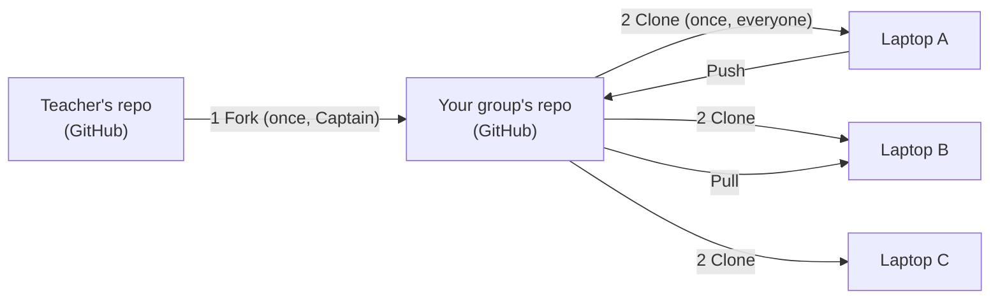

# Lesson 00 — Getting the Code (and Not Losing It)

**Big ideas:** **Version control** (saving a project's history and sharing it safely) and
**project structure** (knowing which files are yours to change).
**You need:** a GitHub account, GitHub Desktop, Android Studio, and your group's Control Hub (Part B).
**Time:** Part A ≈ 45 min (Session 1) · Part B ≈ 25 min (Session 2)

---

## Why are we doing this?
Real robot code is written by a **team**, on **many computers**, over **a whole season**.
Without a system, someone always ends up asking "Whose laptop has the code that worked on Saturday?"
**Git** is that system. **GitHub** stores your team's code online. **GitHub Desktop** is the
app that moves code between GitHub and your computer. Every FRC team and most FTC teams use it.

## Vocabulary
| Word | What it means | Everyday comparison |
|---|---|---|
| **Repository** ("repo") | A project folder that remembers every saved version | A Google Drive folder with version history |
| **Fork** | Your own copy of someone else's repo, on GitHub | Making a copy of the teacher's template doc |
| **Clone** | Downloading a repo to your computer | Downloading the folder so you can work offline |
| **Commit** | A save point with a note about what changed | Saving a game at a checkpoint |
| **Push** | Uploading your commits to GitHub | Uploading your saved file |
| **Pull** | Downloading teammates' commits from GitHub | Refreshing to see what they changed |

## How the code flows

*Fork and clone happen **once**. Push and pull happen **every class**.*

## Group roles (rotate in Part B)
| Role | Job |
|---|---|
| **Captain** | Owns the group repo. Does the fork and invites teammates. |
| **Reader** | Reads each step out loud and checks it off. |
| **Checker** | Compares the screen with each 🛑 checkpoint before the group moves on. |
| **Scout** *(4th member)* | Looks up problems in the [Uh-oh table](#uh-oh-table) and helps whoever is stuck. |

Everyone still does Steps 3–5 on their own computer.

---

# Part A — Get your group's copy

### Step 1 · Captain: fork the starter code
1. Sign in at **github.com**.
2. Go to the repo your teacher gives you: `github.com/____________/FtcRobotController`
3. Click **Fork** (top right).
4. **Owner:** you. **Repository name:** `robotics-group-#` (use your group number).
5. Click **Create fork**.

🛑 **Checkpoint:** The top-left of the page says `your-username/robotics-group-#` and, under it, *forked from …*

### Step 2 · Captain: invite your teammates
1. In your new repo, click **Settings** → **Collaborators** → **Add people**.
2. Add each teammate's GitHub username.
3. **Teammates:** accept the invite from your email or at **github.com/notifications**.

🛑 **Checkpoint:** Every teammate can open the group repo on GitHub.com.

### Step 3 · Everyone: sign in to GitHub Desktop
1. Open **GitHub Desktop** → **File** → **Options** → **Accounts** → **Sign in** to GitHub.com.
2. Go to the **Git** tab of the same window. Make sure your **name** is your real first and last name.
   That name goes on every commit you make, and it's how your teacher sees your work.

### Step 4 · Everyone: clone the group repo
1. **File** → **Clone repository** → **GitHub.com** tab.
2. Choose `captain-username/robotics-group-#`.
3. **Local path:** `C:\Robotics\robotics-group-#` (or the folder your teacher tells you).
   ⚠️ **Not** in OneDrive, Desktop, or Documents if those sync to the cloud. Cloud syncing
   fights with Android Studio and breaks builds.
4. Click **Clone** and wait. It's a big project.

🛑 **Checkpoint:** GitHub Desktop shows **Current repository: robotics-group-#** and says *No local changes*.

### Step 5 · Everyone: open the project in Android Studio
1. Open **Android Studio** → **File** → **Open**.
2. Pick the folder you just cloned. It's the one that contains `settings.gradle`.
3. If asked, click **Trust Project**.
4. **Wait.** The progress bar at the bottom right says *Gradle sync*. The first time can take
   several minutes, so read ahead to Part B while you wait.

🛑 **Checkpoint:** Sync finishes with no red errors. The left panel shows **FtcRobotController** and **TeamCode**.

---

# Part B — Tour, first deploy, first commit

## The map: what's yours and what's not
Make sure the dropdown at the top of the left panel says **Android**. Then expand **TeamCode → java**.

```
robotics-group-#/
│
├── TeamCode/src/main/java/org/firstinspires/ftc/teamcode/
│   ├── lessons/              🟡 Teacher's lesson files. Copy them, don't edit them.
│   └── students/
│       └── yourname/         🟢 YOUR folder. Edit anything in here.
│
├── FtcRobotController/
│   └── src/.../external/samples/   🟡 FIRST's 70+ example OpModes. Copy, don't edit.
│   └── (everything else)           🔴 The Robot Controller app itself. Don't touch.
│
├── curriculum/               📖 Handouts (easier to read on GitHub.com)
├── build.dependencies.gradle 🔴 Sets the FTC SDK version
├── build.gradle, settings.gradle, gradle/, libs/   🔴 Build settings. Don't touch.
└── build/, .gradle/, .idea/  ⚪ Made automatically. Git ignores these.
```

| Color | Meaning |
|---|---|
| 🟢 | Yours. Create, edit, rename, delete. |
| 🟡 | Read and **copy** into your folder. Your teacher may update these files, and if you've edited them, your changes will clash with the update. |
| 🔴 | Changing these can stop the whole project from building, for everyone. |
| ⚪ | Generated files. Ignore them. |

**What's a package?** In Java, a folder of code is called a **package**. The folder path
`org/firstinspires/ftc/teamcode/lessons` becomes the package name
`org.firstinspires.ftc.teamcode.lessons`. That's why the first line of every lesson file is
`package org.firstinspires.ftc.teamcode.lessons;`. The package line **must** match the folder
the file is in.

### Scavenger hunt (as a group, 5 minutes)
1. Open `build.dependencies.gradle` (under **Gradle Scripts**). What FTC SDK version are we using? ______
2. Find `BasicOpMode_Linear.java` in the samples. What `name` does it show on the Driver Station? ______
   Why won't it show up on the Driver Station right now? *(Hint: look at the line just below `@TeleOp`.)*
3. Open `L01_HelloRobot.java`. Copy down its `package` line exactly. ______
4. How many `.java` files are in `lessons`? ______ Which one has no `@TeleOp` or `@Autonomous`? ______

## Step 6 · Make your folder
1. In the left panel, right-click **org.firstinspires.ftc.teamcode** → **New** → **Package**.
2. Type `students.yourfirstname` in **all lowercase, no spaces** (for example `students.ava`).
   If the box already shows `org.firstinspires.ftc.teamcode.`, type after it.
3. Press Enter. Your folder appears inside `students`.

## Step 7 · Copy your first lesson
1. Right-click `lessons/L01_HelloRobot.java` → **Copy**.
2. Right-click **your** folder → **Paste**. In the *Copy Class* window, keep the name and click **OK**.
3. Open **your** copy. Check that the `package` line now ends in `.students.yourname`.
   Android Studio changed it for you.
4. Change the annotation so your program has a **unique** name:
   ```java
   @TeleOp(name = "L01 Hello Robot - Ava", group = "Ava")
   ```
   *Why?* Everyone in your group copies the same lessons. If two programs have the same name,
   the Robot Controller shows a duplicate-name warning and you can't tell whose program is whose.

## Step 8 · Deploy to the robot (take turns)
1. Plug the Control Hub into your laptop with a USB-C **data** cable, and turn the robot on.
2. At the top of Android Studio, the device dropdown should show **REV Robotics Control Hub**.
3. Click the green **▶ Run** button (it should say **TeamCode**).
4. Wait for *Launch succeeded* at the bottom. On the Driver Station, open the TeleOp list
   and find your program under your name.

> 💡 **Important:** Deploying replaces **all** the code on the Control Hub with **your laptop's**
> version. If a teammate pushed new code and you didn't pull it, their programs vanish from the
> robot until someone deploys again. **Pull before you deploy.**

## Step 9 · Your first commit and push
1. Switch to **GitHub Desktop**. The **Changes** tab lists every file you changed.
   You should see **only** files in your folder (marked with a green **+**).
   ⚠️ See anything outside your folder? Don't commit it. Ask your Scout or teacher.
2. Bottom left, in **Summary**, write what you did: `Add Ava's copy of L01 Hello Robot`
3. Click **Commit to main**.
4. Click **Push origin** (top bar).
5. **Teammates:** click **Fetch origin**, then **Pull origin**. Your folder should appear in their Android Studio.

🛑 **Final checkpoint:** On GitHub.com, click **commits** on your group repo. Every member has a commit there with their name on it.

---

# Daily routine
Do this **every** class, starting today.

**▶ Start of class**
1. GitHub Desktop → **Fetch origin** → **Pull origin**.
2. Open Android Studio. If it asks, click **Sync Now**.
3. Copy today's lesson from `lessons/` into **your** folder and give it a unique `name`.

**■ End of class** (5 minutes before cleanup)
1. Make sure your code builds: **Build** → **Make Project** (the 🔨 hammer). Don't push broken code.
2. GitHub Desktop → check the files listed under **Changes** → write a clear summary → **Commit to main**.
3. **Push origin.** Never leave class without pushing.

### The golden rules
1. **Only edit files in your own folder.** (The capstone is the exception. Your group will plan who owns which file.)
2. **Pull when you sit down. Push before you leave.**
3. **Pull before you deploy.**
4. **Commit messages say what you did:** ✅ `Add slow mode to my arcade drive` ❌ `stuff`, `asdf`, `final final 2`

---

# Uh-oh table
| What you see | What it means | What to do |
|---|---|---|
| Push button says **Pull origin** or push is rejected | A teammate pushed first | Click **Pull origin**, then **Push origin** |
| A screen about **conflicts** | You and someone else changed the same lines of the same file | Stop and get your teacher. (Following rule #1 prevents this.) |
| Changes list shows `.idea`, `build`, or hundreds of files | Something isn't being ignored correctly | Don't commit. Get your teacher. |
| Red errors in Android Studio after pulling | Android Studio needs to re-read the project | **File** → **Sync Project with Gradle Files** |
| Group repo isn't in the Clone list | Invite not accepted, or signed into the wrong account | Accept the invite at github.com/notifications, then check **File → Options → Accounts** |
| Control Hub isn't in the device dropdown | Cable or connection problem | Try another port or cable (some cables only charge). Make sure the robot is on. |
| My OpMode isn't on the Driver Station | Deploy failed, or it's under another name | Did the bottom bar say *Launch succeeded*? Look under your group name. Is there an `@Disabled` line? |
| I broke my file and want it back | — | GitHub Desktop: right-click the file in **Changes** → **Discard changes**. ⚠️ This throws away everything since your last commit. |

---
**Exit ticket:**
1. In your own words, what's the difference between a **commit** and a **push**?
2. Why does each person get their own folder?
3. Your teammate says "My program disappeared from the robot!" What probably happened?
