# Lesson 00 — Getting the Code (and Not Losing It)

> **You will learn:** how to get your group's copy of the robot code, find your way around the
> project, put a program on the robot, and save your work so nobody loses it.
> **You need:** a GitHub account, GitHub Desktop, Android Studio, and your group's Control Hub (Part B).
> **Time:** Part A about 45 minutes · Part B about 25 minutes (they can be on different days)

Every step has a picture. The orange numbered circles in each picture match the numbered
steps in the text.

---

## Why are we doing this?
Real robot code is written by a **team**, on **many computers**, over **weeks or months**.
Without a system, someone always ends up asking "Whose laptop has the code that worked on Saturday?"
**Git** is that system. **GitHub** stores your team's code online. **GitHub Desktop** is the
app that moves code between GitHub and your computer. Every FRC team and most FTC teams use it.

## Words you'll need
| Word | What it means | Everyday comparison |
|---|---|---|
| **Repository** ("repo") | A project folder that remembers every saved version | A Google Drive folder with version history |
| **Fork** | Your own copy of someone else's repo, on GitHub | Making a copy of the teacher's template doc |
| **Clone** | Downloading a repo to your computer | Downloading the folder so you can work offline |
| **Commit** | A save point with a note about what changed | Saving a game at a checkpoint |
| **Push** | Uploading your commits to GitHub | Uploading your saved file |
| **Pull** | Downloading teammates' commits from GitHub | Refreshing to see what they changed |

## How the code flows
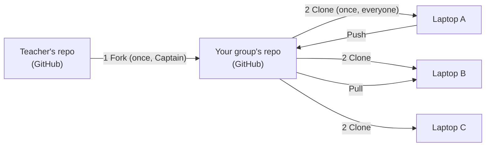
*Fork and clone happen **once**. Push and pull happen **every class**.*

## Group roles for this lesson
| Role | Job |
|---|---|
| **Captain** | Owns the group repo. Does the fork and invites teammates. |
| **Reader** | Reads each step out loud and checks it off. |
| **Checker** | Compares each screen with the 🛑 checkpoint before the group moves on. |
| **Scout** *(4th member)* | Looks up problems in the [Uh-oh table](#uh-oh-table) and helps whoever is stuck. |

Everyone does Steps 3–9 on **their own** laptop.

---

# Part A — Get your group's copy

### Step 1 · Captain: fork the starter code
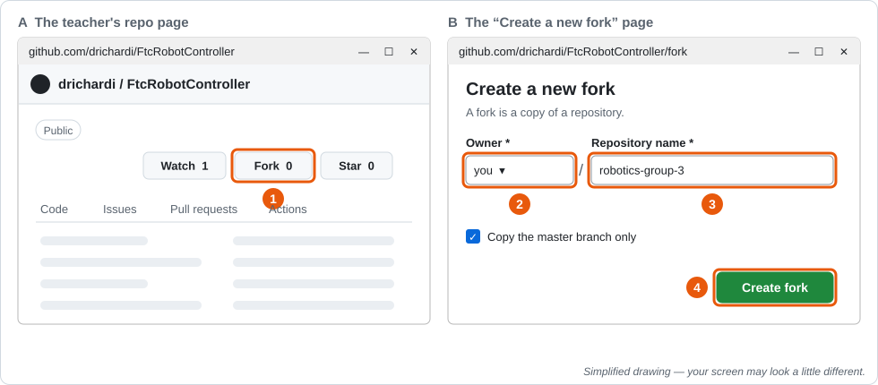

1. Sign in at **github.com** and go to **github.com/drichardi/FtcRobotController**. Click **Fork** (top right).
2. **Owner:** choose yourself.
3. **Repository name:** `robotics-group-#`, using your group number.
4. Click **Create fork**.

🛑 **Checkpoint:** The top of the page says `your-username/robotics-group-#` and, under it, *forked from drichardi/FtcRobotController*.

### Step 2 · Captain: invite your teammates
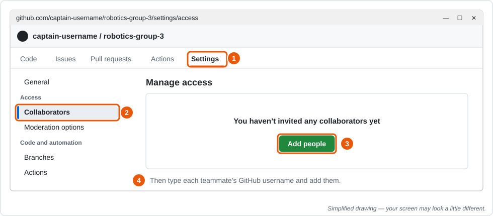

1. In your new repo, click **Settings**.
2. In the left menu, click **Collaborators**.
3. Click **Add people**.
4. Type each teammate's GitHub username and add them.

**Teammates:** accept the invite from your email or at **github.com/notifications**.

🛑 **Checkpoint:** Every teammate can open the group repo on GitHub.com.

### Step 3 · Everyone: sign in to GitHub Desktop and set your name
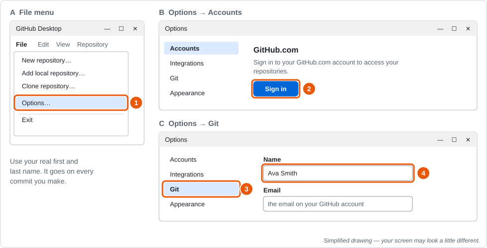

1. Open **GitHub Desktop**, then click **File → Options…**.
2. On the **Accounts** tab, click **Sign in** and sign in to GitHub.com.
3. Click the **Git** tab.
4. Make sure **Name** is your real first and last name. It goes on every commit you make,
   and it's how your teacher sees your work.

### Step 4 · Everyone: clone the group repo
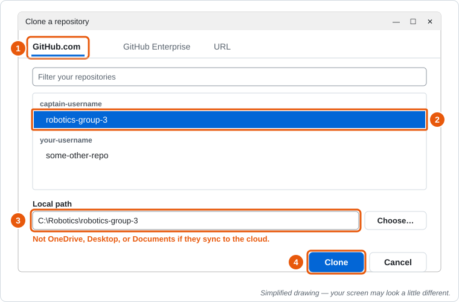

1. Click **File → Clone repository…**, then the **GitHub.com** tab.
2. Click your group repo, `captain-username/robotics-group-#`.
3. **Local path:** `C:\Robotics\robotics-group-#`, or the folder your teacher tells you.
   ⚠️ **Not** in OneDrive, Desktop, or Documents if those sync to the cloud. Cloud syncing
   fights with Android Studio and breaks builds.
4. Click **Clone** and wait. It's a big project.

🛑 **Checkpoint:** The top bar of GitHub Desktop shows **Current repository: robotics-group-#**.

### Step 5 · Everyone: open the project in Android Studio
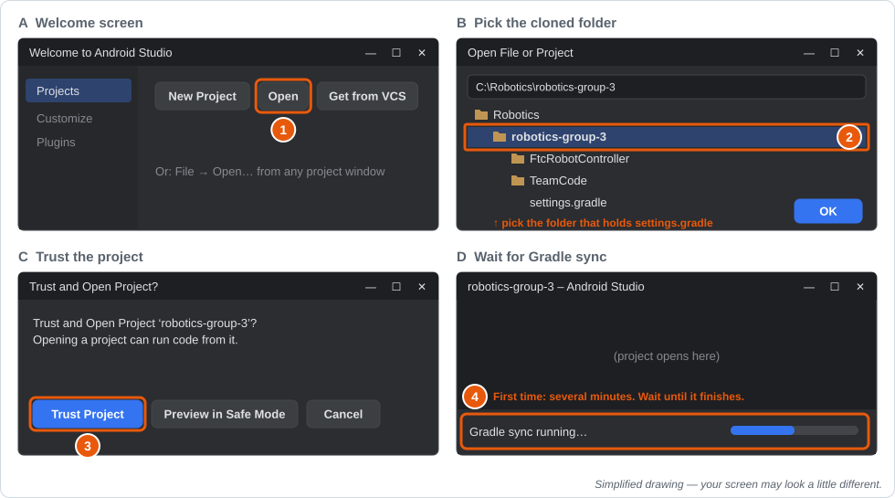

1. Open **Android Studio** and click **Open** (or **File → Open…** if a project is already open).
2. Pick the folder you just cloned. It's the one with `settings.gradle` inside. Click **OK**.
3. If asked, click **Trust Project**.
4. **Wait** for *Gradle sync* to finish (progress bar at the bottom). The first time can take
   several minutes, so read Part B while you wait.

🛑 **Checkpoint:** Sync finishes with no red errors. The left panel shows **FtcRobotController** and **TeamCode**.

---

# Part B — Tour, first deploy, first commit

## The map: what's yours and what's not
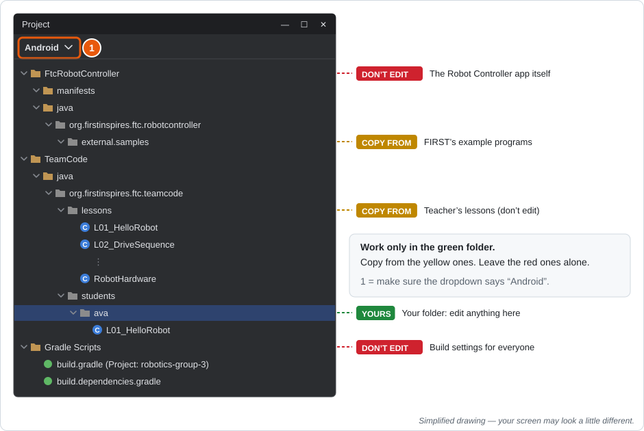

Make sure the dropdown at the top of the left panel says **Android**. Then expand **TeamCode → java**.

| Color | Meaning |
|---|---|
| 🟢 **Yours** | Your own folder in `students/`. Create, edit, rename, delete. |
| 🟡 **Copy from** | The teacher's `lessons/` and FIRST's `samples/`. Read them and **copy** them into your folder. Your teacher may update these files, and if you've edited them, your changes will clash with the update. |
| 🔴 **Don't edit** | The rest of `FtcRobotController` and the Gradle Scripts. Changing these can stop the whole project from building, for everyone. |

> **What's a package?** In Java, a folder of code is called a **package**. The folder path
> `org/firstinspires/ftc/teamcode/lessons` becomes the package name
> `org.firstinspires.ftc.teamcode.lessons`. That's why the first line of every lesson file is
> `package org.firstinspires.ftc.teamcode.lessons;`. The package line **must** match the folder
> the file is in.

### Scavenger hunt (as a group, 5 minutes)
1. Open `build.dependencies.gradle` (under **Gradle Scripts**). What FTC SDK version are we using? ______
2. Find `BasicOpMode_Linear.java` in the samples. What `name` does it show on the Driver Station? ______
   Why won't it show up on the Driver Station right now? *(Hint: look at the line just below `@TeleOp`.)*
3. Open `L01_HelloRobot.java`. Copy down its `package` line exactly. ______
4. How many `.java` files are in `lessons`? ______ Which one has no `@TeleOp` or `@Autonomous`? ______

### Step 6 · Make your own folder
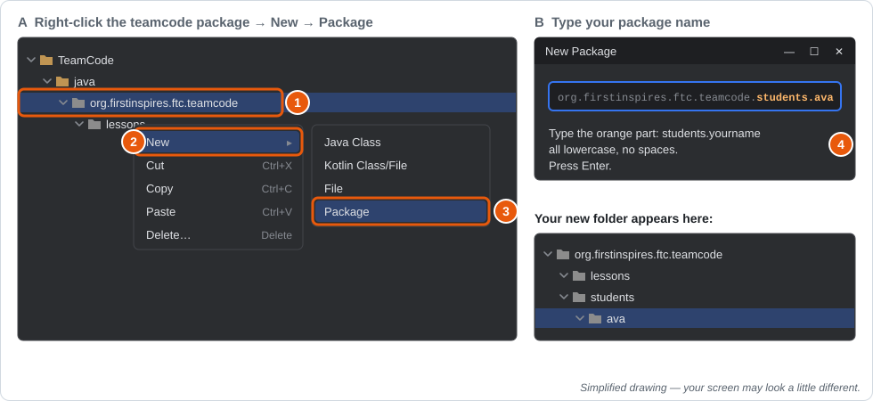

1. In the left panel, right-click **org.firstinspires.ftc.teamcode**.
2. Choose **New**.
3. Choose **Package**.
4. Type `students.yourfirstname` in **all lowercase, no spaces** (for example `students.ava`).
   If the box already shows `org.firstinspires.ftc.teamcode.`, type after it. Press **Enter**.

Your folder appears inside `students`.

### Step 7 · Copy your first lesson
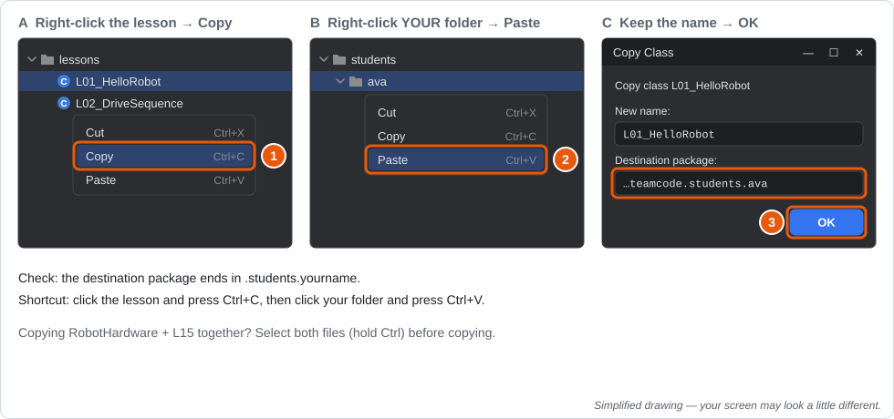

1. Right-click `lessons/L01_HelloRobot.java` → **Copy**.
2. Right-click **your** folder → **Paste**.
3. In the *Copy Class* window, keep the name. Check that the destination package ends in
   `.students.yourname`, then click **OK**.

Now edit **your** copy:

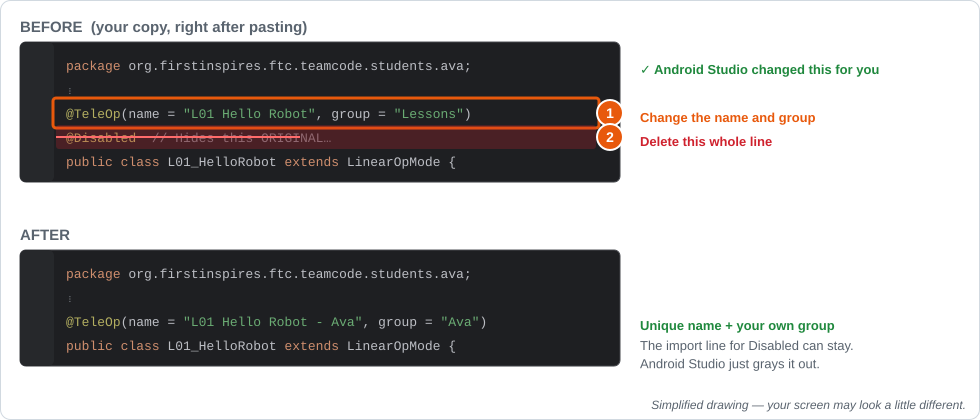

1. **Give it a unique name.** Change the `@TeleOp` line to use your name, like the picture.
   Everyone in your group copies the same lessons. If two programs have the same name, the
   Robot Controller shows a duplicate-name warning and you can't tell whose program is whose.
2. **Delete the `@Disabled` line.** The teacher's originals are hidden so they don't fill up the
   menu. Your copy needs that line gone so it shows up.

### Step 8 · Put it on the robot (take turns)
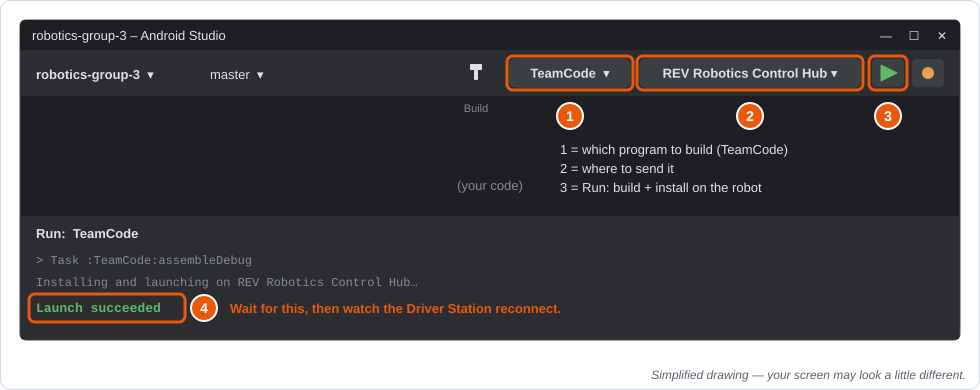

1. Plug the Control Hub into your laptop with a USB-C **data** cable, and turn the robot on.
   Check that the left dropdown says **TeamCode**.
2. The device dropdown should show **REV Robotics Control Hub**.
3. Click the green **▶ Run** button.
4. Wait for *Launch succeeded*. Then the Driver Station reconnects.

> 💡 **Important:** Running replaces **all** the code on the Control Hub with **your laptop's**
> version. If a teammate pushed new code and you didn't pull it, their programs vanish from the
> robot until someone runs it again. **Pull before you put code on the robot.**

Now find and run your program on the Driver Station:

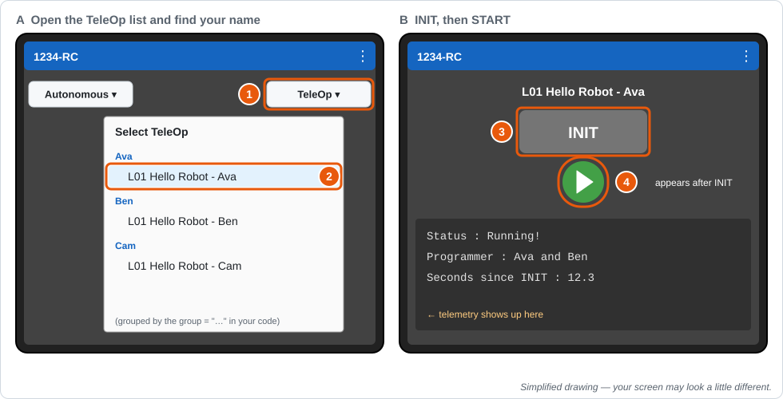

1. Tap the **TeleOp** list.
2. Find your program under **your name**.
3. Press **INIT**.
4. Press **▶ START**. Your telemetry appears at the bottom. Press **■** to stop.

📘 More about putting code on the robot (over Wi-Fi too), cleaning up a crowded menu, and fixing
errors: [**Deploying and Managing Programs**](../reference/deploying-and-managing.md).

### Step 9 · Your first commit and push
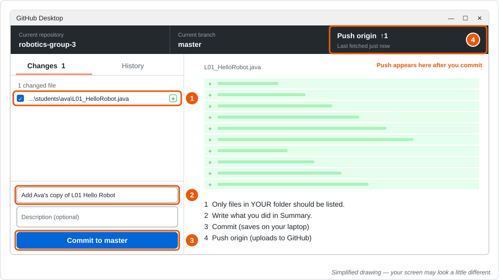

1. Switch to **GitHub Desktop**. The **Changes** tab lists every file you changed. You should
   see **only** files in your folder.
   ⚠️ See anything outside your folder? Don't commit it. Ask your Scout or teacher.
2. In **Summary** (bottom left), write what you did: `Add Ava's copy of L01 Hello Robot`
3. Click **Commit to master**. This saves a snapshot on your laptop.
4. Click **Push origin** (top bar). This uploads it to GitHub.

**Teammates:** click **Fetch origin**, then **Pull origin**. Your folder appears in their Android Studio.

🛑 **Final checkpoint:** On GitHub.com, click **commits** on your group repo. Every member has a
commit there with their name on it.

---

# Daily routine
Do this **every** class, starting today.

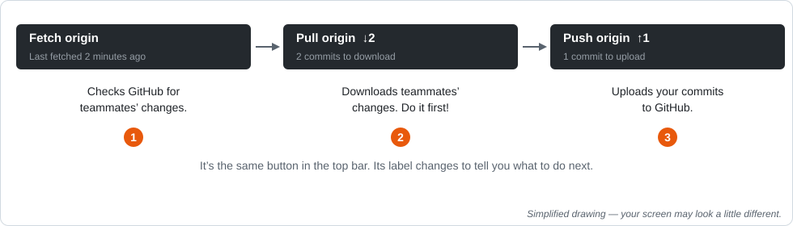

**▶ When you sit down**
1. GitHub Desktop → **Fetch origin** → **Pull origin** (if it appears).
2. Open Android Studio. If it asks, click **Sync Now**.
3. To start a new lesson: copy it from `lessons/` into **your** folder, give it a unique `name`,
   and delete `@Disabled` (just like Step 7).

**■ Before you leave** (5 minutes before cleanup)
1. Make sure your code builds: **Build → Make Project**. Don't push broken code, because it
   stops your whole group from putting code on the robot.
2. GitHub Desktop → check the files under **Changes** → write a clear Summary → **Commit to master**.
3. **Push origin.** Never leave without pushing.

### The golden rules
1. **Only edit files in your own folder.**
2. **Pull when you sit down. Push before you leave.**
3. **Pull before you put code on the robot.**
4. **Commit messages say what you did:** ✅ `Add slow mode to my arcade drive` ❌ `stuff`, `asdf`, `final final 2`

---

# Uh-oh table
| What you see | What it means | What to do |
|---|---|---|
| Push button says **Pull origin**, or push is rejected | A teammate pushed first | Click **Pull origin**, then **Push origin** |
| A screen about **conflicts** | You and someone else changed the same lines of the same file | Stop and get your teacher. (Following rule #1 prevents this.) |
| Changes list shows `.idea`, `build`, or hundreds of files | Something isn't being ignored correctly | Don't commit. Get your teacher. |
| Red errors in Android Studio after pulling | Android Studio needs to re-read the project | **File → Sync Project with Gradle Files** |
| Group repo isn't in the Clone list | Invite not accepted, or signed into the wrong account | Accept the invite at github.com/notifications, then check **File → Options → Accounts** |
| Control Hub isn't in the device dropdown | Cable or connection problem | Try another port or cable (some cables only charge). Make sure the robot is on. |
| My program isn't on the Driver Station | `@Disabled` is still there, the deploy failed, or it's in the other list | Delete `@Disabled` from **your copy**. Did it say *Launch succeeded*? Autonomous programs are in a separate list from TeleOp. |
| Build fails because of an error in a teammate's file | They pushed code that doesn't build | Tell them. They fix it and push, then you pull. |
| I broke my file and want it back | — | GitHub Desktop: right-click the file in **Changes** → **Discard changes**. ⚠️ This throws away everything since your last commit. |

---
## ✅ Check yourself
- [ ] I can find my own folder in Android Studio.
- [ ] I can copy a lesson into my folder, rename it, and delete `@Disabled`.
- [ ] I can put code on the robot and find my program on the Driver Station.
- [ ] I can commit and push, and I can see my commit on GitHub.com.

**Exit ticket:**
1. In your own words, what's the difference between a **commit** and a **push**?
2. Why does each person get their own folder?
3. Your teammate says "My program disappeared from the robot!" What probably happened?
