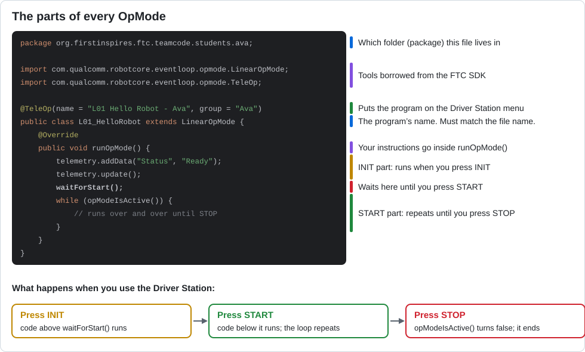

# Lesson 01 — Hello, Robot!

> **You will learn:** the parts every Java robot program has, how to show text on the Driver
> Station, and how to read error messages.
> **You need:** a Control Hub and Driver Station. Nothing has to be plugged into the hub.
> **Time:** about 40 minutes · **Program type:** TeleOp
> **Code:** [`L01_HelloRobot.java`](../../TeamCode/src/main/java/org/firstinspires/ftc/teamcode/lessons/L01_HelloRobot.java)

## Before you start
You already copied this file into your `students/yourname` folder in
[Lesson 00, Step 7](00-getting-the-code.md#step-7--copy-your-first-lesson). Work on **your copy**,
not the one in `lessons/`.

---

## 📖 Learn it

In Blocks, you snapped puzzle pieces together. In Java, you **type** the same instructions as
text. The ideas are the same, but Java has strict rules about the *shape* of the program.



**An OpMode** is a robot program, the thing you pick from the Driver Station menu. Every
OpMode has the parts in the picture above. You don't need to memorize them yet; you'll see them
again in every lesson.

**Telemetry** is how the robot "talks" to you. It shows text on the Driver Station screen:
```java
telemetry.addData("Status", "Running!");   // adds a line:  Status : Running!
telemetry.update();                        // sends all the lines to the screen
```

**Java's grammar rules** (Blocks never made you think about these):
| Rule | Example |
|---|---|
| Every instruction ends with a semicolon `;` | `telemetry.update();` |
| Curly braces `{ }` group code together, like the "mouth" of a Blocks block | `while (opModeIsActive()) { ... }` |
| Capital letters matter | `telemetry` works. `Telemetry` doesn't. |
| Text goes inside double quotes | `"Hello"` |
| `//` starts a comment: a note for humans that the robot ignores | `// this is a comment` |

| Blocks | Java |
|---|---|
| purple `runOpMode` block | `public void runOpMode() { ... }` |
| `call waitForStart` | `waitForStart();` |
| `call Telemetry.addData` | `telemetry.addData("key", value);` |
| `call Telemetry.update` | `telemetry.update();` |

---

## 1. Predict (before you run anything)
Read your copy of the code. Write your answers down.
1. What text will the Driver Station show after you press **INIT**?
2. What text will it show after you press **START**?
3. One number on the screen will keep changing. Which one, and why?

## 2. Run
Put the code on the robot (pull first!), pick **your** copy from the TeleOp list (for example
`L01 Hello Robot - Ava`), then press INIT → START → STOP.
Were your predictions right? Circle any you got wrong.

## 3. Investigate
1. Find `waitForStart();`. Which lines run *before* it, and which run *after*?
2. What do you think `telemetry.update()` does? Comment it out (put `//` in front of it) inside the loop and run again. What changed?
3. Find the `@TeleOp(...)` line. Change `name` to something else. Where does that change show up?

## 4. Modify
1. Replace `"Your name here"` with your name.
2. Add a new line of telemetry that shows your team number.

<details><summary>💡 Hint for #2</summary>

Copy one of the existing `telemetry.addData(...)` lines and change both parts: the label in
quotes and the value. Put your new line *before* `telemetry.update();`.

</details>

## 5. 🔨 Break-It Lab
Professional programmers see error messages *all day*. Learning to read them is a superpower.
Make **one** change at a time, then build with **Build → Make Project** (🔨). Write down the
error, then undo the change (**Ctrl+Z**).

| Change you make | Did it build? | What did the error message say (in your own words)? |
|---|---|---|
| Delete a `;` at the end of a line | | |
| Change `telemetry` to `Telemetry` | | |
| Delete the very last `}` in the file | | |
| Change `"Status"` to `"Stat us"` | | |
| Change `waitForStart();` to `waitforstart();` | | |

One of these changes builds just fine. Why do you think that is?

<details><summary>💡 Where do I see the error?</summary>

Android Studio underlines problems in red as you type. After you click 🔨, the **Build** panel at
the bottom lists each error. Click an error to jump to the line. Tip: a missing `;` is often
reported on the line *after* the real problem.

</details>

## 6. Make
Make the Driver Station show a 3-line "robot introduction": its name, what it will do, and a fun fact.

---

## ✅ Check yourself
- [ ] I can point to the INIT part and the START part of an OpMode.
- [ ] I can add a line of telemetry.
- [ ] I can find and read an error message, and fix it.

**Exit ticket:** Name three rules of Java that Blocks never made you think about.

## 🆘 Stuck?
| Problem | Try this |
|---|---|
| My program isn't on the Driver Station | Did you delete `@Disabled` in your copy? Did the deploy say *Launch succeeded*? |
| Red underline I don't understand | Hover over it to read the message. Check the line above it for a missing `;`. |
| Telemetry doesn't change | Is `telemetry.update();` still there after your `addData` lines? |

More help: [Blocks → Java cheat sheet](../reference/blocks-to-java.md)

---
<!-- lesson-nav -->
[← Lesson 00: Getting the Code](00-getting-the-code.md) · [All lessons](../START-HERE.md#lessons) · [Lesson 02: Drive in Sequence →](02-drive-sequence.md)
