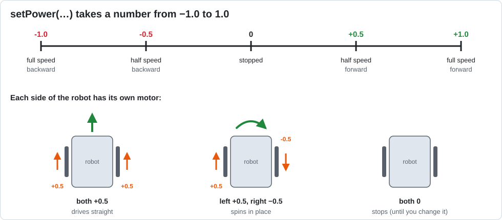

# Lesson 02 — Drive in Sequence

> **You will learn:** how to make motors move, and how a program runs one step at a time.
> **You need:** the two drive motors (`left_drive`, `right_drive`). Put the robot on a block
> (wheels off the ground) for the first run!
> **Time:** about 35 minutes · **Program type:** Autonomous
> **Code:** [`L02_DriveSequence.java`](../../TeamCode/src/main/java/org/firstinspires/ftc/teamcode/lessons/L02_DriveSequence.java)

## Before you start
1. **Pull** in GitHub Desktop.
2. **Copy** `L02_DriveSequence.java` from `lessons/` into your `students/yourname` folder.
3. In your copy, give it a unique name on the `@Autonomous` line (for example
   `"L02 Drive Sequence - Ava"`, `group = "Ava"`) and **delete `@Disabled`**.

[Forgot how? Lesson 00, Step 7 has pictures.](00-getting-the-code.md#step-7--copy-your-first-lesson)

---

## 📖 Learn it

**Sequence** means the computer runs your code **one line at a time, top to bottom**. It never
skips ahead and never does two lines at once.

**Finding a motor.** Before you can use a motor, the program has to find it by the name in the
robot configuration:
```java
DcMotor leftDrive = hardwareMap.get(DcMotor.class, "left_drive");
```
Read it as: *"Make a motor variable called `leftDrive`, and connect it to the motor named
`left_drive` in the configuration."* The name in quotes must match **exactly**.

**Making it move.** `setPower` takes a number from −1.0 to 1.0:



**Waiting.** `sleep(1000);` pauses the program for 1000 **milliseconds** (1 second). The motors
**keep running** during the sleep. A motor keeps whatever power you last gave it until you change it.

**Why `setDirection(REVERSE)`?** The two drive motors face opposite directions on the robot. If
both got `+0.5` with no reversing, one wheel would spin forward and the other backward, and the
robot would spin. Reversing one motor fixes that.

**Autonomous** programs run on their own with no gamepad. They're listed in the **Autonomous**
list on the Driver Station (not the TeleOp list).

| Blocks | Java |
|---|---|
| `set leftDrive.Power to 0.5` | `leftDrive.setPower(0.5);` |
| `call sleep 1000` | `sleep(1000);` |
| `set leftDrive.Direction to REVERSE` | `leftDrive.setDirection(DcMotor.Direction.REVERSE);` |

---

## 1. Predict
On graph paper, draw the path you think the robot will take. Mark each numbered step from the code comments.

## 2. Run
Run it with the wheels off the ground first, then on the floor. How close was your drawing?

## 3. Investigate
1. `sleep(1000)` waits 1000 *milliseconds*. How many seconds is that? What would `sleep(250)` be?
2. While the program is sleeping, are the motors running or stopped? How do you know?
3. Comment out `leftDrive.setDirection(DcMotor.Direction.REVERSE);`. Predict, then test: what does step 1 do now?
4. Delete Step 4 (the two `setPower(0)` lines). What does the robot do in those last 2 seconds?

## 4. Modify
1. Make the robot drive **backward** for step 1.
2. Make the turn in step 2 closer to exactly 90°. Change only one number.

<details><summary>💡 Hint for #1</summary>

Look at the number line above. Which numbers make a motor spin the other way?

</details>

<details><summary>💡 Hint for #2</summary>

The turn's *power* and its *time* both matter. Changing just the `sleep` time for that step is
the easiest way to get a bigger or smaller turn.

</details>

## 5. Make
Program the robot to drive the shape of a capital **L**, then a capital **Z**. Draw your plan
first, with arrows and a time for each step.

---

## ✅ Check yourself
- [ ] I can make a motor move forward, backward, or stop.
- [ ] I can explain why the motors keep running during `sleep()`.
- [ ] I can plan a path as a numbered list of steps.

**Exit ticket:** In Blocks, what block did the job of `sleep()`? Why does a motor keep spinning during `sleep()`?

## 🆘 Stuck?
| Problem | Try this |
|---|---|
| Error at INIT: *unable to find a hardware device* | The name in quotes doesn't match the robot configuration. Check capitals and `_`. |
| Robot spins when it should go straight | One motor's direction is wrong. Try reversing the other motor instead. |
| Can't find the program on the Driver Station | It's an **Autonomous** program, so look in the Autonomous list. |
| Robot never stops | Does your last step set both powers to `0`? |

---
<!-- lesson-nav -->
[← Lesson 01: Hello, Robot!](01-hello-robot.md) · [All lessons](../START-HERE.md#lessons) · [Lesson 03: Variables and Types →](03-variables.md)
