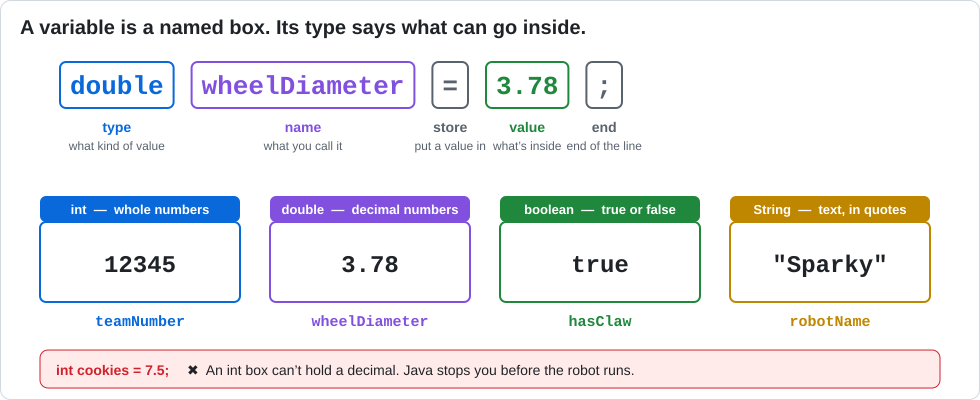

# Lesson 03 — Variables and Types

> **You will learn:** how to store values in variables, the four most common Java types, and
> how Java does math.
> **You need:** a Control Hub and Driver Station. No motors needed.
> **Time:** about 35 minutes · **Program type:** TeleOp (telemetry only)
> **Code:** [`L03_Variables.java`](../../TeamCode/src/main/java/org/firstinspires/ftc/teamcode/lessons/L03_Variables.java)

## Before you start
1. **Pull** in GitHub Desktop.
2. **Copy** `L03_Variables.java` into your `students/yourname` folder.
3. In your copy, give it a unique `name` and **delete `@Disabled`**.

[Forgot how? Lesson 00, Step 7 has pictures.](00-getting-the-code.md#step-7--copy-your-first-lesson)

---

## 📖 Learn it

A **variable** is a named box that holds a value. In Blocks you could put anything in any
variable. In Java, every box has a **type** that says what can go inside, and Java checks it
**before** the robot runs. That catches lots of mistakes early.



**Making a variable** (called *declaring* it): `type name = value;`
```java
double wheelDiameter = 3.78;
```
**Changing it later:** leave off the type. You only say the type the first time.
```java
wheelDiameter = 4.0;
```

**Math works like a calculator:** `+` `-` `*` (times) `/` (divide), plus one new one:
`%` gives the **remainder** after dividing. `7 % 2` is `1`, because 7 ÷ 2 = 3 remainder **1**.

**Shortcuts you'll see a lot:**
| Shortcut | Means |
|---|---|
| `score += 10;` | `score = score + 10;` |
| `score++;` | `score = score + 1;` |
| `score--;` | `score = score - 1;` |

**Gluing text together:** `+` between Strings joins them. `"Team " + 12345` becomes `"Team 12345"`.

**Naming rules:** start with a lowercase letter, no spaces, and capitalize each new word:
`wheelDiameterInches`. This style is called *camelCase*.

---

## 1. Predict
Fill in what you think each telemetry line will show **before** you run it.

| Telemetry label | Your prediction | Actual |
|---|---|---|
| Wheel circumference (in) | | |
| 7 / 2 with ints | | |
| 7 % 2 remainder | | |
| 7.0 / 2.0 with doubles | | |
| Score | | |

## 2. Run
Run it and fill in the "Actual" column. Which surprised you?

## 3. Investigate
1. Why does `7 / 2` give a different answer than `7.0 / 2.0`?
2. Change `int cookies = 7;` to `int cookies = 7.5;`. What error do you get? What is Java protecting you from?
3. Remove the quotes: `String robotName = Sparky;`. What error do you get? Why?
4. Trace `score` line by line. Write its value after each of the 4 lines that change it.

<details><summary>💡 Hint for #1</summary>

When **both** numbers are `int`s, Java does *whole-number* division and throws away anything
after the decimal point. It doesn't round, it just drops it.

</details>

## 4. Modify
1. Change the wheel diameter to match **your** robot's wheels. (Measure them! 96 mm = 3.78 in.)
2. Add a variable `double targetInches = 100;` and calculate **how many wheel rotations** it takes to drive that far. Show it on telemetry.

<details><summary>💡 Hint for #2</summary>

One wheel rotation moves the robot one *circumference*. How many circumferences fit into 100 inches?
Make a new `double` variable for the answer, then add a `telemetry.addData` line for it.

</details>

## 5. Make
Create a "robot stat card" that uses at least one variable of each of the 4 types and at least two math operations.

---

## ✅ Check yourself
- [ ] I can declare a variable with the right type.
- [ ] I can explain why `7 / 2` is `3` in Java.
- [ ] I can change a variable's value and show it on telemetry.

**Exit ticket:** Which type would you use for: (a) the number of times the robot has turned, (b) motor power, (c) whether the claw is open, (d) your robot's name? Why?

## 🆘 Stuck?
| Problem | Try this |
|---|---|
| *incompatible types* | You put the wrong kind of value in a box (like a decimal in an `int`). |
| *cannot find symbol* | A name is misspelled, or a String is missing its quotes. |
| *variable is already defined* | You wrote the type twice. Leave the type off when changing a variable. |

---
<!-- lesson-nav -->
[← Lesson 02: Drive in Sequence](02-drive-sequence.md) · [All lessons](../START-HERE.md#lessons) · [Lesson 04: Reading the Gamepad →](04-gamepad-input.md)
