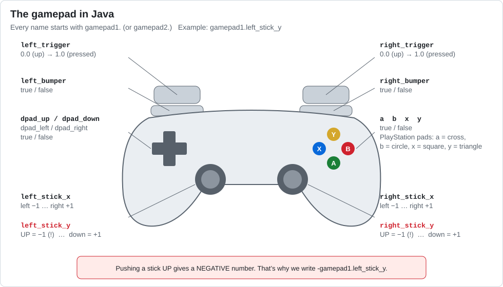
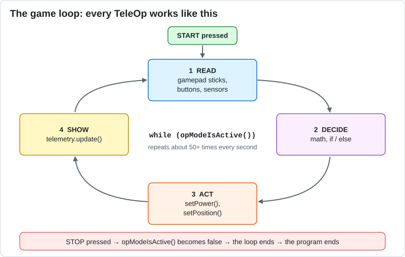

# Lesson 04 — Reading the Gamepad

> **You will learn:** how the program reads the gamepad, and the **game loop** that every
> driver-controlled program uses.
> **You need:** a Control Hub, Driver Station, and gamepad. No motors needed.
> **Time:** about 30 minutes · **Program type:** TeleOp
> **Code:** [`L04_GamepadInput.java`](../../TeamCode/src/main/java/org/firstinspires/ftc/teamcode/lessons/L04_GamepadInput.java)

## Before you start
1. **Pull** in GitHub Desktop.
2. **Copy** `L04_GamepadInput.java` into your `students/yourname` folder.
3. In your copy, give it a unique `name` and **delete `@Disabled`**.

[Forgot how? Lesson 00, Step 7 has pictures.](00-getting-the-code.md#step-7--copy-your-first-lesson)

---

## 📖 Learn it

To the program, the gamepad is just a set of **variables** that update many times per second.
Every name starts with `gamepad1.` (the first driver) or `gamepad2.` (the second driver).



There are two kinds of values:
- **Sticks and triggers** are `double`s: decimal numbers like `0.0`, `-0.75`, `1.0`.
- **Buttons, bumpers, and the D-pad** are `boolean`s: `true` while held, `false` when not.

⚠️ **The surprise:** pushing a stick **up** gives a **negative** number. That's why robot code
writes `-gamepad1.left_stick_y`. The minus sign flips it so up is positive.

### The game loop
A program has to check the gamepad **over and over**, or it would only see where the stick was
at one instant. So every TeleOp has a loop like this:



```java
while (opModeIsActive()) {
    // 1 READ   double forward = -gamepad1.left_stick_y;
    // 2 DECIDE (math and if statements go here)
    // 3 ACT    (set motor powers here, starting next lesson)
    // 4 SHOW   telemetry.addData(...);  telemetry.update();
}
```
`while (...)` means "keep repeating the code in `{ }` as long as this is true."
`opModeIsActive()` is true from START until STOP.

---

## 1. Predict
1. When you push the left stick all the way **up**, what number will `left stick Y (raw)` show?
2. What type of value will the `A button` line show?

## 2. Run
Move every stick and press every button that the code reads. Fill in this table:

| Input | Value at rest | Smallest value | Largest value | Type |
|---|---|---|---|---|
| left_stick_y | | | | |
| right_stick_x | | | | |
| right_trigger | | | | |
| a | | | | |

## 3. Investigate
1. Why do we write `double forward = -leftY;`? What would be confusing if we didn't?
2. Do the sticks read exactly `0.0` when you let go? Why might that matter for a robot?
3. Move the five `double`/`boolean` lines from inside the loop to **above** the loop. Predict first, then try it. What happens, and why? (Then put them back.)

<details><summary>💡 Hint for #3</summary>

Code above the loop runs **once**. Code inside the loop runs **again and again**. When do the
variables get their values in each case?

</details>

## 4. Modify
1. Add telemetry for `gamepad1.left_stick_x`, `gamepad1.b`, and `gamepad1.left_trigger`.
2. Show the right trigger as a percentage (0 to 100) instead of 0.0 to 1.0.

<details><summary>💡 Hint for #2</summary>

0.0 → 0, 0.5 → 50, 1.0 → 100. What do you multiply by?

</details>

## 5. Make
Create a variable `double throttle` that equals `forward` multiplied by the right trigger. Show
it on telemetry. What would this be useful for on a real robot?

---

## ✅ Check yourself
- [ ] I can read any stick, trigger, or button into a variable.
- [ ] I know why stick Y values are flipped with a minus sign.
- [ ] I can explain what the game loop does and why it repeats.

**Exit ticket:** In your own words, what is "the game loop" and why does every TeleOp need one?

## 🆘 Stuck?
| Problem | Try this |
|---|---|
| Values never change | Are the lines that read the gamepad *inside* the `while` loop? |
| Gamepad does nothing at all | On the Driver Station, press **Start + A** on the gamepad to make it gamepad 1. |
| *cannot find symbol* on a gamepad name | Check the spelling against the gamepad picture: they use `_` (like `left_stick_y`). |

---
<!-- lesson-nav -->
[← Lesson 03: Variables and Types](03-variables.md) · [All lessons](../START-HERE.md#lessons) · [Lesson 05: Tank Drive →](05-tank-drive.md)
