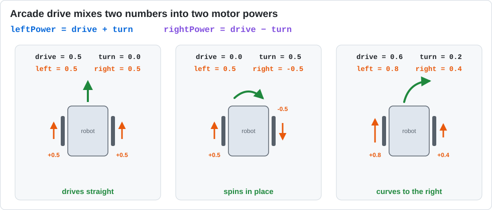

# Lesson 06 — Arcade Drive

> **You will learn:** how to combine variables with math (expressions) to get the behavior you want.
> **You need:** the two drive motors and a gamepad.
> **Time:** about 35 minutes · **Program type:** TeleOp
> **Code:** [`L06_ArcadeDrive.java`](../../TeamCode/src/main/java/org/firstinspires/ftc/teamcode/lessons/L06_ArcadeDrive.java)

## Before you start
1. **Pull** in GitHub Desktop.
2. **Copy** `L06_ArcadeDrive.java` into your `students/yourname` folder.
3. In your copy, give it a unique `name` and **delete `@Disabled`**.

[Forgot how? Lesson 00, Step 7 has pictures.](00-getting-the-code.md#step-7--copy-your-first-lesson)

---

## 📖 Learn it

**Arcade drive** works like a video game: one stick goes **forward/back**, the other stick
**turns**. The program has to turn those two numbers into two motor powers. It uses two short
formulas:

```java
leftPower  = drive + turn;
rightPower = drive - turn;
```



Why does it work? To turn **right**, the left wheels need to go faster than the right wheels.
Adding `turn` speeds up the left side, and subtracting `turn` slows down the right side.

**An expression** is any piece of code that calculates a value, like `drive + turn` or
`leftPower * maxSpeed`.

**Clipping.** `drive + turn` can be as big as `2.0`, but motors only accept −1.0 to 1.0.
`Range.clip(value, -1.0, 1.0)` keeps a number inside a range:
| `Range.clip(x, -1.0, 1.0)` | gives |
|---|---|
| `x = 0.4` | `0.4` (already inside, no change) |
| `x = 1.7` | `1.0` |
| `x = -3.0` | `-1.0` |

**Formatted telemetry.** `"%.2f"` means "show this decimal number with 2 digits after the
point." It keeps the numbers on the screen easy to read.

---

## 1. Predict
Fill in the table using `leftPower = drive + turn` and `rightPower = drive - turn` (before clipping).

| drive | turn | leftPower | rightPower | What the robot does |
|---|---|---|---|---|
| 1.0 | 0.0 | | | |
| 0.0 | 1.0 | | | |
| 0.5 | 0.5 | | | |
| 1.0 | 1.0 | | | |
| -1.0 | 0.0 | | | |

## 2. Run
Drive it. Compare arcade to tank drive (Lesson 05). Which do you prefer, and why?

## 3. Investigate
1. Look at row 4 in your table. Why do we need `Range.clip()`?
2. Delete both `Range.clip` lines. Can you *feel* a difference while driving? (Try full forward + full turn.)
3. What does `"%.2f / %.2f"` do in the telemetry line? Change `2` to `4` and see.

<details><summary>💡 Hint for #2</summary>

Without clipping, `leftPower` can be 2.0. Then the code multiplies by `maxSpeed` (0.6).
What is 2.0 × 0.6? Is that still under the speed limit you set?

</details>

## 4. Modify
1. Make it **one-stick** arcade: both drive and turn come from the *left* stick.
2. Make turning gentler than driving by multiplying `turn` by `0.6`.

<details><summary>💡 Hint for #1</summary>

Look at the gamepad picture in Lesson 04. Which name is the left stick's side-to-side value?

</details>

## 5. Make: Input curves
Small stick movements should give *very* small power for precise driving.
Replace `drive` with `drive * Math.abs(drive)` (and do the same for `turn`).
`Math.abs` gives the number without its minus sign.
Fill in: stick at 0.5 → power ____. Stick at 1.0 → power ____. Why does this help?

---

## ✅ Check yourself
- [ ] I can explain the arcade formulas in my own words.
- [ ] I can explain what `Range.clip` does and why it's needed.
- [ ] I can change which stick controls what.

**Exit ticket:** Write the arcade drive formulas from memory and explain why the right side uses `-`.

## 🆘 Stuck?
| Problem | Try this |
|---|---|
| Turning goes the wrong way | Swap the `+` and `-` in the two formulas, or put a `-` in front of the turn stick. |
| Robot drifts with sticks centered | Watch the telemetry. If drive or turn isn't 0.00 at rest, the stick may be worn. |
| *cannot find symbol: Range* | The `import com.qualcomm.robotcore.util.Range;` line is missing at the top. |
