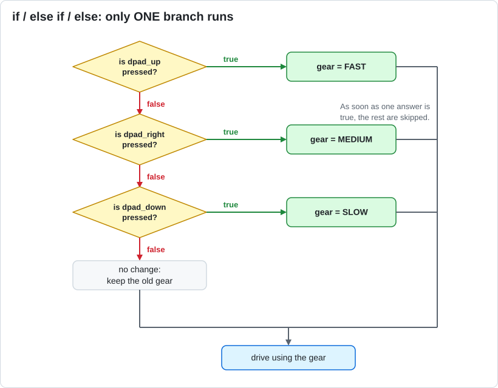

# Lesson 07 — Buttons and `if` / `else`

> **You will learn:** how a program makes decisions, and where a variable "lives" (scope).
> **You need:** the two drive motors and a gamepad.
> **Time:** about 40 minutes · **Program type:** TeleOp
> **Code:** [`L07_ButtonsAndIf.java`](../../TeamCode/src/main/java/org/firstinspires/ftc/teamcode/lessons/L07_ButtonsAndIf.java)

## Before you start
1. **Pull** in GitHub Desktop.
2. **Copy** `L07_ButtonsAndIf.java` into your `students/yourname` folder.
3. In your copy, give it a unique `name` and **delete `@Disabled`**.

[Forgot how? Lesson 00, Step 7 has pictures.](00-getting-the-code.md#step-7--copy-your-first-lesson)

---

## 📖 Learn it

An **`if` statement** asks a true/false question. If the answer is `true`, the code in its
`{ }` runs. If it's `false`, it's skipped.

```java
if (gamepad1.left_bumper) {
    speed = 0.2;          // runs only while the bumper is held
} else {
    speed = 0.6;          // runs when it isn't
}
```

You can chain questions with **`else if`**. Java checks them **top to bottom**, and only the
**first** true one runs. The rest are skipped:



**Comparing values** (these give `true` or `false`):
| Java | Means |
|---|---|
| `a == b` | is equal to (two `=` signs!) |
| `a != b` | is not equal to |
| `a > b`, `a < b` | greater than, less than |
| `a >= b`, `a <= b` | greater or equal, less or equal |

⚠️ `=` **stores** a value. `==` **compares** two values. Mixing them up is one of the most common bugs.

### Scope: where a variable lives
A variable only exists inside the `{ }` where it was declared.
- Declared **inside** the game loop → it's created fresh **every pass**, and forgets its old value.
- Declared **above** the loop → it's created **once** and **remembers** its value between passes.

That's why `gearSpeed` is declared above the loop: the robot has to *remember* which gear you picked.

---

## 1. Predict
1. You tap D-pad UP once and let go. What gear is the robot in one second later?
2. You hold the left bumper while in FAST gear. What is the speed limit? What happens when you let go?
3. You press D-pad UP and D-pad DOWN at the **same time**. Which gear wins? Why?

## 2. Run
Test all three predictions.

## 3. Investigate
1. Move the line `double gearSpeed = 0.6;` (and `gearName`) **inside** the `while` loop. What breaks? Explain why using the word *scope*.
2. Why is there no `else` at the end of the D-pad `if` chain? What would happen if you added `else { gearSpeed = 0.6; }`?
3. `=` and `==` are different in Java. Which one *stores* a value? Which one *compares*?

<details><summary>💡 Hint for #1</summary>

If the variable is created inside the loop, what value does it start with at the beginning of
**every** pass, even right after you pressed a D-pad button?

</details>

## 4. Modify
1. Add a 4th gear on D-pad LEFT called `"TURBO"` at `0.85`.
2. Make precision mode use the **right** bumper instead.

<details><summary>💡 Hint for #1</summary>

Copy one whole `} else if (...) { ... }` block and change the button, speed, and name.
Make sure every `{` still has a matching `}`.

</details>

## 5. Make
Replace the gears with an *analog* speed: the right trigger controls max speed from 0.3 (not
pressed) to 1.0 (fully pressed). Write the formula on paper first.

<details><summary>💡 Hint</summary>

The trigger goes from 0.0 to 1.0. You want 0.3 when it's 0.0, and 1.0 when it's 1.0.
Start with `0.3 + ...`. How much more do you need to add when the trigger is fully pressed?

</details>

---

## ✅ Check yourself
- [ ] I can write an `if` / `else if` / `else` chain.
- [ ] I can explain why only one branch of a chain runs.
- [ ] I can explain when a variable should be declared outside the loop.

**Exit ticket:** Rewrite this in Java: "If the A button is pressed, show 'Hello'. Otherwise, show 'Press A'."

## 🆘 Stuck?
| Problem | Try this |
|---|---|
| *incompatible types: … cannot be converted to boolean* | You probably wrote `=` where you meant `==`. |
| Gear doesn't stick when I let go | The gear variable is declared inside the loop. Move it above. |
| *'else' without 'if'* | A `}` is missing or extra just before the `else`. Click a brace to see its partner. |
