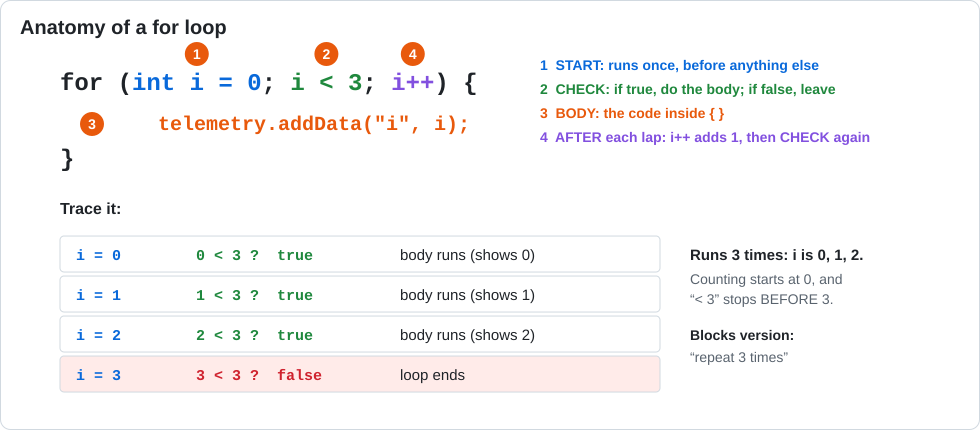

# Lesson 09 — Loops: Drive a Square

> **You will learn:** how to repeat code with `for` and `while` loops, and how to spot
> off-by-one bugs.
> **You need:** the two drive motors.
> **Time:** about 40 minutes · **Program type:** Autonomous
> **Code:** [`L09_Loops.java`](../../TeamCode/src/main/java/org/firstinspires/ftc/teamcode/lessons/L09_Loops.java)

## Before you start
1. **Pull** in GitHub Desktop.
2. **Copy** `L09_Loops.java` into your `students/yourname` folder.
3. In your copy, give it a unique `name` and **delete `@Disabled`**.

[Forgot how? Lesson 00, Step 7 has pictures.](00-getting-the-code.md#step-7--copy-your-first-lesson)

---

## 📖 Learn it

A square is "drive, turn" four times. Instead of copying the same code four times, a **loop**
repeats it for you.

### The `for` loop: repeat a set number of times


Its three parts are separated by semicolons:
```java
for (int side = 1; side <= 4; side++) {
    // drive and turn
}
```
| Part | Means |
|---|---|
| `int side = 1` | Make a counter called `side` that starts at 1 |
| `side <= 4` | Keep going while this is true |
| `side++` | After each lap, add 1 to the counter |

### The `while` loop: repeat as long as something is true
You've been using one since Lesson 01: `while (opModeIsActive())`. It doesn't count. It just
checks its question before every lap.
```java
int countdown = 5;
while (countdown > 0) {
    // ...
    countdown--;          // without this, the loop would never end!
}
```

| Use a… | When you… | Robot example |
|---|---|---|
| `for` loop | know how many times | drive 4 sides of a square |
| `while` loop | are waiting for something to change | drive until a sensor is pressed |

**Off-by-one bugs.** Getting the start or end of a loop wrong by one is one of the most common
bugs in all of programming. Always ask: *"What is the first value? What is the last value? How
many laps is that?"*

**Safety.** In robot code, loops include `&& opModeIsActive()` so pressing STOP ends the loop
right away.

---

## 1. Predict
1. How many times will `Side` appear on telemetry? What numbers will it show?
2. What numbers will the countdown show, in order? Does it ever show `0`?

## 2. Run
Run it. Tune `driveTimeMs` and `turnTimeMs` until the square nearly closes. Record your best values.

## 3. Investigate
1. Change `side <= 4` to `side < 4`. How many sides now?
2. Change `side = 1` to `side = 0` (keep `<= 4`). How many sides now?
3. Why do both loops include `&& opModeIsActive()`? What could happen if they didn't?
4. Translate the `for` loop into the Blocks you used to use. Which block matches it best?

<details><summary>💡 Hint for #1 and #2</summary>

Make a little trace table like the one in the diagram: write each value of `side`, then
whether the check is true or false. Count the trues.

</details>

## 4. Modify
1. Make it drive a **triangle**. What has to change besides the number of sides?
2. Make the countdown start at 10 and count by 2s.

<details><summary>💡 Hint for #1</summary>

A square turns 90° at each corner. A triangle turns 120°. Will the turn need more time or less?

</details>

## 5. Make: Square spiral
Make each side **longer** than the one before by using the loop variable `side` in the math for
the drive time. Drive 8 sides.

<details><summary>💡 Hint</summary>

Inside the loop, make a new variable, like `long sideTime = 300 + side * 200;`, and use it in
the `sleep` for driving straight. What is `sideTime` when `side` is 1? When it's 8?

</details>

---

## ✅ Check yourself
- [ ] I can name the three parts of a `for` loop.
- [ ] I can predict how many times a loop will run.
- [ ] I can choose between a `for` loop and a `while` loop.

**Exit ticket:** When would you choose a `for` loop instead of a `while` loop? Give a robot example of each.

## 🆘 Stuck?
| Problem | Try this |
|---|---|
| The square doesn't close | Tune `turnTimeMs` first, then `driveTimeMs`. Floors and batteries change the result. |
| The loop never ends | Does the loop's question ever become false? Is something changing the counter? |
| STOP doesn't stop it right away | Add `&& opModeIsActive()` to the loop's question. |
