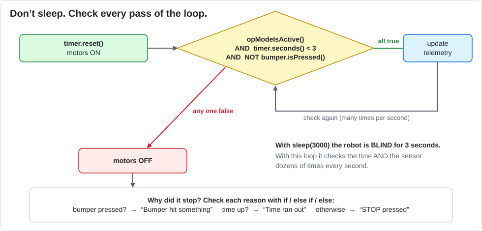

# Lesson 10 — Timers: Stop Sleeping, Start Checking

> **You will learn:** how to use a timer and a loop so the robot keeps paying attention while it moves.
> **You need:** the two drive motors and the `touch_sensor` (as a front bumper, or press it by hand).
> **Time:** about 40 minutes · **Program type:** Autonomous
> **Code:** [`L10_TimerAuto.java`](../../TeamCode/src/main/java/org/firstinspires/ftc/teamcode/lessons/L10_TimerAuto.java)

## Before you start
1. **Pull** in GitHub Desktop.
2. **Copy** `L10_TimerAuto.java` into your `students/yourname` folder.
3. In your copy, give it a unique `name` and **delete `@Disabled`**.

[Forgot how? Lesson 00, Step 7 has pictures.](00-getting-the-code.md#step-7--copy-your-first-lesson)

---

## 📖 Learn it

**The problem with `sleep()`:** while the robot sleeps, it's *blind*. It can't check sensors,
can't update telemetry, and can't notice that something went wrong.

**The fix:** turn the motors on, then loop **while** everything is still OK, checking every
pass. The robot checks dozens of times every second.



**ElapsedTime** is a stopwatch:
```java
ElapsedTime timer = new ElapsedTime();   // make a stopwatch
timer.reset();                           // set it back to 0
timer.seconds()                          // how many seconds since the last reset, like 1.37
```
(`new` builds an object. You'll learn about objects in Lesson 15.)

**A loop question with three parts.** The loop keeps going only while **all three** are true:
```java
while (opModeIsActive() && timer.seconds() < 3.0 && !bumper.isPressed()) {
    // motors are already on; just update telemetry
}
```
As soon as **any one** becomes false, the loop ends. Afterward, the program checks *which* one
it was with `if` / `else if` / `else`.

---

## 1. Predict
1. Nobody touches the sensor. When does the robot stop, and what does "Stopped because" say?
2. You press the sensor after 1 second. What happens?
3. In Lesson 02, the telemetry only changed between steps. What will it do here while driving?

## 2. Run
Test all three. Try pressing STOP partway through, too.

## 3. Investigate
1. The `while` loop's body only updates telemetry. So what is actually keeping the motors running?
2. Read the loop question out loud as an English sentence.
3. After the loop, why do we need an `if / else if / else` to know *why* it ended?

<details><summary>💡 Hint for #1</summary>

Look at the lines just **before** the loop. Remember from Lesson 02: a motor keeps its power
until you change it.

</details>

## 4. Modify
1. After stopping, make the robot **back up for 1 second** using a second `while` loop and `timer.reset()`. No `sleep()` allowed!
2. Change the time limit to 5 seconds using only one edit.

<details><summary>💡 Hint for #1</summary>

Follow the same pattern as the first drive: reset the timer, set the powers (negative this
time), loop while `opModeIsActive()` and the timer is under 1.0, then set the powers to 0.

</details>

## 5. Make: Back and forth
Make the robot drive forward until the bumper is hit, back up 1 second, and repeat **3 times**.
*(You'll need a loop inside a loop. These are called **nested loops**.)*

<details><summary>💡 Hint</summary>

Put a `for` loop (3 times) around **both** `while` loops. Watch out: if the bumper is still
pressed when the next forward loop starts, that loop ends instantly. Which order of steps
avoids that?

</details>

---

## ✅ Check yourself
- [ ] I can use `ElapsedTime` to time something.
- [ ] I can write a loop that stops on a time limit OR a sensor.
- [ ] I can explain why a loop is better than `sleep()` for this.

**Exit ticket:** Give two reasons why `while + timer` is better than `sleep()` for autonomous.

## 🆘 Stuck?
| Problem | Try this |
|---|---|
| It stops instantly | Is the sensor already pressed? Is `timer.reset()` right before the loop? |
| It never stops | Check the loop question. Are you using `&&`, and is the `!` in front of the sensor? |
| *cannot find symbol: ElapsedTime* | The `import com.qualcomm.robotcore.util.ElapsedTime;` line is missing. |
