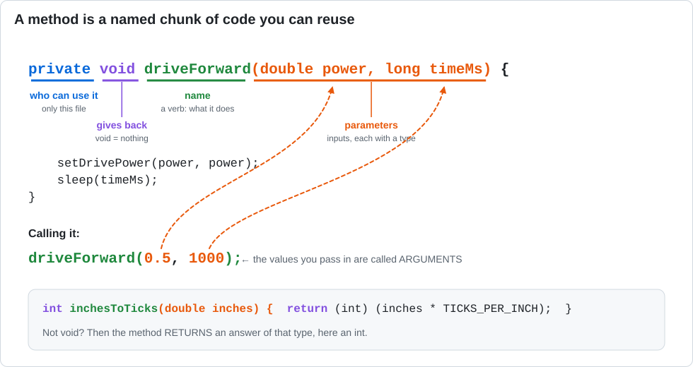

# Lesson 11 — Methods: Teach the Robot New Words

> **You will learn:** how to write your own methods (named, reusable chunks of code) with parameters.
> **You need:** the two drive motors.
> **Time:** about 40 minutes · **Program type:** Autonomous
> **Code:** [`L11_Methods.java`](../../TeamCode/src/main/java/org/firstinspires/ftc/teamcode/lessons/L11_Methods.java)

## Before you start
1. **Pull** in GitHub Desktop.
2. **Copy** `L11_Methods.java` into your `students/yourname` folder.
3. In your copy, give it a unique `name` and **delete `@Disabled`**.

[Forgot how? Lesson 00, Step 7 has pictures.](00-getting-the-code.md#step-7--copy-your-first-lesson)

---

## 📖 Learn it

A **method** gives a name to a chunk of code. Then you can use the name instead of repeating
the details. In Blocks, these were the "function" blocks you could make yourself. You've
already been *using* methods all along: `setPower`, `sleep`, `waitForStart`.



| Word | Means | In `driveForward(0.5, 1000)` |
|---|---|---|
| **Method** | A named chunk of code | `driveForward` |
| **Parameter** | An input variable in the method's definition | `power`, `timeMs` |
| **Argument** | The actual value you pass in when you call it | `0.5`, `1000` |
| **`void`** | The method does something but doesn't give back an answer | |

**Calling** a method runs its code, then comes back to the next line:
```java
driveForward(0.5, 1000);   // jump into driveForward, run it, come back
turnRight(0.5, 450);       // then this line runs
```

**Fields.** Methods can only see variables declared in their own `{ }`. To let **every** method
use the motors, `leftDrive` and `rightDrive` moved to the top of the class, outside any method.
Variables there are called **fields**.

**Why bother?** Compare `runOpMode()` here with Lesson 09. Same robot, but this one reads like
instructions to a human: drive, turn, drive, turn. This idea of hiding details behind a good
name is called **abstraction**, and it's one of the most important ideas in programming.

---

## 1. Predict
Open your L09 and L11 copies side by side. Will the robot do anything different? Which `runOpMode()` is easier to read?

## 2. Run
Run L11 and confirm it matches L09.

## 3. Investigate
1. In `driveForward(0.5, 1000)`, which values are the **arguments**? What are the matching **parameters** called inside the method?
2. `leftDrive` and `rightDrive` moved from inside `runOpMode()` to the top of the class. Why did they have to move? *(Try moving them back inside `runOpMode()` and read the error.)*
3. How many places in the file call `leftDrive.setPower`? Why is that a good thing if a motor gets rewired?
4. What does `void` mean?

## 4. Modify
1. Write a `turnLeft(double power, long timeMs)` method.
2. Write a `driveBackward(double power, long timeMs)` method that **calls `driveForward`** instead of `setDrivePower`.

<details><summary>💡 Hint for #1</summary>

Copy `turnRight` and rename it. Which wheel needs to go backward for a left turn?

</details>

<details><summary>💡 Hint for #2</summary>

Driving backward is driving forward with a negative power. The whole method body can be one line.

</details>

## 5. Make
Write a method `drivePolygon(int sides, long turnTimeMs)` that drives any regular shape.
Then make `runOpMode()` drive a triangle, then a square, each with **one line** of code.

<details><summary>💡 Hint</summary>

Move the `for` loop from `runOpMode()` into your new method, and use the `sides` parameter
instead of `4`.

</details>

---

## ✅ Check yourself
- [ ] I can write a method with parameters.
- [ ] I can call my method with different arguments.
- [ ] I can explain the difference between a parameter and an argument.

**Exit ticket:** In Blocks, what did you call the thing Java calls a "method"? Name one method from the FTC SDK you've used that you *didn't* write.

## 🆘 Stuck?
| Problem | Try this |
|---|---|
| *cannot find symbol* for a motor inside a method | The motor variable is declared inside `runOpMode()`. It needs to be a field at the top of the class. |
| *method … cannot be applied to given types* | You called it with the wrong number or types of arguments. Compare the call with the definition. |
| *illegal start of expression* | A method is accidentally inside another method. Each method needs its own closing `}`. |
