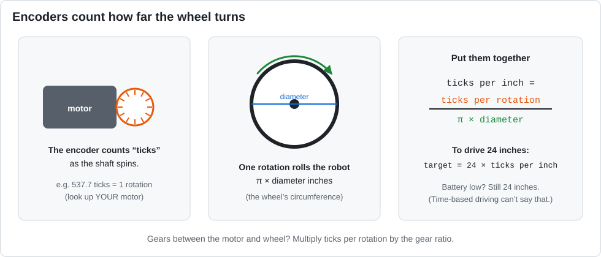

# Lesson 12 — Encoders and Return Values

> **You will learn:** how to drive an exact distance with encoders, how a method can **return**
> an answer, and how constants keep important numbers in one place.
> **You need:** the two drive motors, **with encoder cables plugged in**.
> **Time:** about 45 minutes · **Program type:** Autonomous
> **Code:** [`L12_EncoderDrive.java`](../../TeamCode/src/main/java/org/firstinspires/ftc/teamcode/lessons/L12_EncoderDrive.java)

## Before you start
1. **Pull** in GitHub Desktop.
2. **Copy** `L12_EncoderDrive.java` into your `students/yourname` folder.
3. In your copy, give it a unique `name` and **delete `@Disabled`**.
4. Look up **your** motor's ticks per revolution and measure **your** wheel diameter. Update the
   constants at the top of your copy.

[Forgot how to copy? Lesson 00, Step 7 has pictures.](00-getting-the-code.md#step-7--copy-your-first-lesson)

---

## 📖 Learn it

**The problem with timing:** `sleep(1000)` drives for 1 second, but *how far* that goes
depends on the battery, the floor, and the robot's weight.

**Encoders** fix it. An encoder counts how far the motor shaft turns, in **ticks**. If you know
how many ticks make one wheel rotation, and how far one rotation rolls the robot, you can drive
by **inches**.



**Constants** are values that never change while the program runs. Java marks them
`static final`, and by convention their names are `ALL_CAPS`:
```java
static final double WHEEL_DIAMETER_INCHES = 3.78;
```
Put a number in a constant instead of typing it all over the code, so a fix happens in one place.

**Methods that return an answer.** In Lesson 11 every method was `void`. This one gives back an `int`:
```java
private int inchesToTicks(double inches) {
    return (int) (inches * TICKS_PER_INCH);
}
int ticks = inchesToTicks(24);    // the answer comes back and goes into ticks
```
`(int)` is a **cast**. It turns a `double` into an `int` by chopping off the decimal part.

**RUN_TO_POSITION.** Instead of setting power and waiting, you tell the motor *where* to go:
1. `setTargetPosition(target)` sets where to stop (in ticks)
2. `setMode(RUN_TO_POSITION)` tells the motor controller to drive there by itself
3. `setPower(0.5)` sets how fast to get there
4. `isBusy()` stays `true` until it arrives

---

## 1. Predict (use a calculator)
1. `TICKS_PER_INCH = (TICKS_PER_MOTOR_REV × GEAR_RATIO) ÷ (WHEEL_DIAMETER × π)` = ______
2. `inchesToTicks(24)` returns ______
3. Where will the robot end up compared to where it started?

## 2. Run
Put a strip of tape at the start. Measure where the robot ends up after the first move. Was it 24"?

## 3. Investigate
1. Why does `inchesToTicks` have `int` in front of its name instead of `void`?
2. What does `(int)` do to `1086.7`? Is that rounding?
3. Try a low battery (or set power to 0.3). Does the robot still go 24"? Compare that with driving by time in Lesson 09.
4. What is the 5-second `timeout` for? Describe a situation where it saves you.

<details><summary>💡 Hint for #4</summary>

What happens to the `while (… isBusy() …)` loop if the robot is pushed against a wall and the
wheels can't reach their target?

</details>

## 4. Modify: Calibrate
Drive 48". Measure the actual distance. Adjust `WHEEL_DIAMETER_INCHES` until it's within ½".
Record the before and after in your engineering notebook.

<details><summary>💡 Hint</summary>

If the robot went **too far**, the program thinks the wheel is smaller than it really is.
A good starting guess: new diameter = old diameter × (actual distance ÷ 48).

</details>

## 5. Make
Write `double ticksToInches(int ticks)`, the reverse of `inchesToTicks`. Use it to show "inches
traveled so far" on telemetry while driving.

<details><summary>💡 Hint</summary>

If inches × TICKS_PER_INCH gives ticks, what do you do to ticks to get inches back?
Use `leftDrive.getCurrentPosition()` for the ticks.

</details>

---

## ✅ Check yourself
- [ ] I can explain what an encoder measures.
- [ ] I can write a method that returns a value, and use the answer.
- [ ] I can calibrate a constant by measuring.

**Exit ticket:** Why are constants written in `ALL_CAPS`, and why is it better to use `TICKS_PER_INCH` than to type `45.28` everywhere?

## 🆘 Stuck?
| Problem | Try this |
|---|---|
| Robot doesn't move at all | `setTargetPosition` must come **before** `setMode(RUN_TO_POSITION)`. |
| One wheel spins forever | That motor's encoder cable is unplugged, or its direction is wrong so it drives *away* from its target. |
| Distance is way off | Check `TICKS_PER_MOTOR_REV` for **your** motor, and the gear ratio. |
