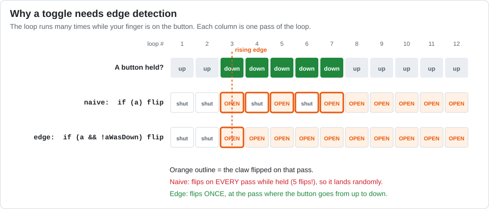

# Lesson 13 — Toggles: Remembering the Past

> **You will learn:** how to make one button tap switch something on and off, using **state**
> (memory) and **edge detection**.
> **You need:** the `claw` servo.
> **Time:** about 40 minutes · **Program type:** TeleOp
> **Code:** [`L13_Toggle.java`](../../TeamCode/src/main/java/org/firstinspires/ftc/teamcode/lessons/L13_Toggle.java)

## Before you start
1. **Pull** in GitHub Desktop.
2. **Copy** `L13_Toggle.java` into your `students/yourname` folder.
3. In your copy, give it a unique `name` and **delete `@Disabled`**.

[Forgot how? Lesson 00, Step 7 has pictures.](00-getting-the-code.md#step-7--copy-your-first-lesson)

---

## 📖 Learn it

**Goal:** tap A once to open the claw, tap A again to close it.

**Servos** move to a **position** instead of spinning: `claw.setPosition(0.7);` goes to the
spot that's 70% of the way through its range. (Positions go from 0.0 to 1.0.)

**Why the obvious way doesn't work.** The game loop runs about 50 times a second. Even a
quick tap holds the button down for several passes of the loop. If the code says "flip the claw
whenever A is down," it flips on *every* one of those passes:



**The fix is edge detection:** only act at the exact moment the button goes from **up**
(last pass) to **down** (this pass). That moment is called the **rising edge**. To find it, the
program has to **remember** what the button was doing on the last pass:
```java
boolean aWasDownLastLoop = false;           // memory: declared ABOVE the loop

while (opModeIsActive()) {
    boolean aIsDownNow = gamepad1.a;
    if (aIsDownNow && !aWasDownLastLoop) {  // down now, but NOT down last time
        clawOpen = !clawOpen;               // ! flips true <-> false
    }
    aWasDownLastLoop = aIsDownNow;          // remember for next pass
}
```

**State** is anything the program remembers between passes of the loop: here, whether the claw
is open and whether A was down last time.

**A tiny if/else for values.** `clawOpen ? "OPEN" : "CLOSED"` means "if `clawOpen` is true,
use `"OPEN"`, otherwise use `"CLOSED"`." It's called the *ternary operator*.

---

## 1. Experiment first: the broken toggle
In your copy, temporarily replace the edge-detection `if` with this naive version:
```java
if (gamepad1.a) {
    clawOpen = !clawOpen;
    toggleCount++;
}
```
Tap A ten times. Write down `Times toggled`. Why is it so much bigger than 10?
Now put the real code back (**Ctrl+Z** a few times works).

## 2. Predict
Trace the loop by hand. A is held down for 3 passes in a row, then released.

| Pass # | `aIsDownNow` | `aWasDownLastLoop` (at start) | Toggle? | `clawOpen` after |
|---|---|---|---|---|
| 1 | false | false | | false |
| 2 | true | | | |
| 3 | true | | | |
| 4 | true | | | |
| 5 | false | | | |

## 3. Run
Test it. Tune `CLAW_OPEN_POSITION` and `CLAW_CLOSED_POSITION` so the claw doesn't strain.

## 4. Investigate
1. Which single line is the program's "memory"? What happens if you delete it?
2. What happens if you move `aWasDownLastLoop = aIsDownNow;` to *above* the `if`?
3. The SDK has a shortcut: `gamepad1.aWasPressed()`. Replace your `if` condition with it. Does it behave the same? Why is it still worth knowing how to build it yourself?

<details><summary>💡 Hint for #2</summary>

If the memory is updated *before* the `if`, what are `aIsDownNow` and `aWasDownLastLoop`
always equal to when the `if` checks them?

</details>

## 5. Modify
Add a second toggle on **X** that switches between "fast" and "slow" mode and shows it on telemetry.

<details><summary>💡 Hint</summary>

You need your own copy of each piece: a `boolean slowMode`, a `boolean xWasDownLastLoop`,
the edge-detection `if`, and the "remember" line. Keep the A and X pieces separate.

</details>

## 6. Make
Use D-pad UP and DOWN (with edge detection) to count a number up and down from 0 to 10, shown
on telemetry. Each tap should change it by exactly 1.

<details><summary>💡 Hint</summary>

Use an `int` declared above the loop. Each D-pad button needs its own "was down last loop"
variable. To keep it between 0 and 10, add `&& number < 10` (or `> 0`) to the right `if`.

</details>

---

## ✅ Check yourself
- [ ] I can explain why "if A is pressed, flip" doesn't work.
- [ ] I can write edge detection for any button.
- [ ] I can make a servo move to a position.

**Exit ticket:** Explain to a Blocks programmer why "if A is pressed, flip the claw" doesn't work.

## 🆘 Stuck?
| Problem | Try this |
|---|---|
| The toggle flickers or lands randomly | The memory line is missing, or it's above the `if`. |
| It never toggles | The memory line is above the `if`, or the memory variable is declared inside the loop. |
| The servo buzzes or strains | It's being pushed past what the claw can reach. Bring the positions closer together. |
