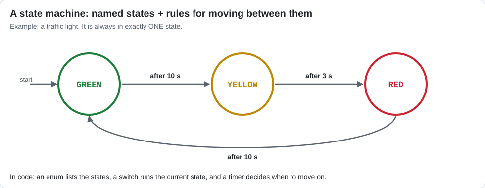

# Lesson 14 — State Machines

> **You will learn:** how to break a multi-step job into named **states** using `enum` and
> `switch`, so the robot can do things without ever sleeping.
> **You need:** the two drive motors and the `touch_sensor`.
> **Time:** about 45 minutes · **Program type:** Autonomous
> **Code:** [`L14_StateMachineAuto.java`](../../TeamCode/src/main/java/org/firstinspires/ftc/teamcode/lessons/L14_StateMachineAuto.java)

## Before you start
1. **Pull** in GitHub Desktop.
2. **Copy** `L14_StateMachineAuto.java` into your `students/yourname` folder.
3. In your copy, give it a unique `name` and **delete `@Disabled`**.

[Forgot how? Lesson 00, Step 7 has pictures.](00-getting-the-code.md#step-7--copy-your-first-lesson)

---

## 📖 Learn it

A **state machine** is a set of named **states**, plus **rules** for moving from one state to
the next. The machine is always in exactly **one** state.



**An `enum`** is a type *you* create, with a fixed list of possible values:
```java
enum Light { GREEN, YELLOW, RED }
Light current = Light.GREEN;      // can ONLY be GREEN, YELLOW, or RED
```
That's safer than using numbers like `0`, `1`, `2`: you can't mistype it, and it explains itself.

**A `switch`** runs different code depending on a value:
```java
switch (current) {
    case GREEN:
        // do green things; check if it's time to change
        break;            // done with this case
    case YELLOW:
        // ...
        break;
}
```
⚠️ Don't forget `break;`. Without it, Java keeps going into the next case ("falls through").

**Putting it together:** one loop, no `sleep()`. Each pass, the robot asks two questions:
1. *What state am I in?* (the `switch`) → do that state's action.
2. *Is it time to move on?* (an `if`) → change the state and reset the timer.

Because nothing sleeps, the same loop could also run an arm, update telemetry, and watch other
sensors **at the same time**. Real FTC and FRC teams build their autonomous code this way.

---

## 1. Draw it
Read the code. On paper, draw **this program's** state diagram: one bubble per state, one arrow
per transition. Label every arrow with *what makes it happen*.

## 2. Predict
List the states in the order telemetry will show them. How long will the robot spend in each one if the bumper is never pressed?

## 3. Run
Run it once with a wall in front of the robot and once without.

## 4. Investigate
1. What is an `enum`? Why is `AutoState.BACK_UP` better than using the number `1` to mean "back up"?
2. Delete `stateTimer.reset();` from the DRIVE_TO_WALL transition. Predict, then test: what happens to BACK_UP?
3. Delete one `break;`. What happens? *(Look up "switch fall-through".)*
4. There is no `sleep()` anywhere. Why does that matter if you wanted to raise an arm *while* driving?

<details><summary>💡 Hint for #2</summary>

When BACK_UP starts, what does `stateTimer.seconds()` already say if nobody reset it?
BACK_UP ends when that number is over 0.5.

</details>

## 5. Modify
1. Add a `WAIT` state at the very beginning that waits 1 second before driving. That gives whoever pressed START time to step back from the robot.
2. Change the `TURN` state to turn the other way.

<details><summary>💡 Hint for #1</summary>

Three changes: add `WAIT` to the enum list, make the starting state `WAIT`, and add a
`case WAIT:` that stops the motors and moves to `DRIVE_TO_WALL` after 1 second. Don't forget
`stateTimer.reset()` and `break;`.

</details>

## 6. Make
Design your own state machine with at least **four** states for something you want the robot
to do. Draw the diagram first, have a classmate check it, then code it.

---

## ✅ Check yourself
- [ ] I can draw a state diagram for a program.
- [ ] I can create an `enum` and use it in a `switch`.
- [ ] I can add a new state to a state machine.

**Exit ticket:** Name the states and transitions for a microwave oven (door, start button, timer, beep).

## 🆘 Stuck?
| Problem | Try this |
|---|---|
| A state ends instantly | Did the previous transition reset `stateTimer`? |
| Two states seem to run at once | A `break;` is missing. |
| The program never ends | Does some transition finally set the state to `DONE`? |

---
<!-- lesson-nav -->
[← Lesson 13: Toggles](13-toggle.md) · [All lessons](../START-HERE.md#lessons) · [Lesson 15: Robot Class: TeleOp →](15-robot-class-teleop.md)
