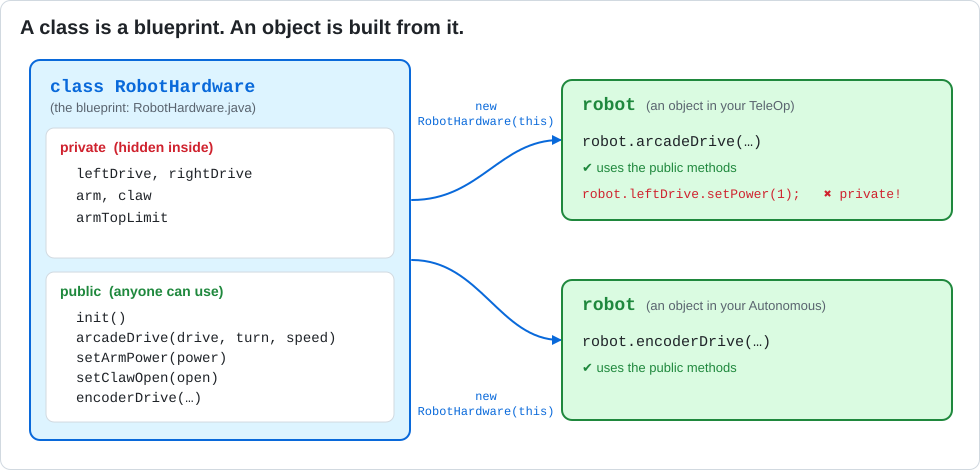

# Lesson 15 — Classes and Objects: One Robot, Many Programs

> **You will learn:** how a **class** bundles all of the robot's hardware and skills in one
> place, and how programs use it as an **object**.
> **You need:** everything: drive motors, `arm`, `claw`, and `touch_sensor`.
> **Time:** about 45 minutes · **Program type:** TeleOp
> **Code:** [`RobotHardware.java`](../../TeamCode/src/main/java/org/firstinspires/ftc/teamcode/lessons/RobotHardware.java) and [`L15_TeleOpWithClass.java`](../../TeamCode/src/main/java/org/firstinspires/ftc/teamcode/lessons/L15_TeleOpWithClass.java)

## Before you start
1. **Pull** in GitHub Desktop.
2. Copy **both** `RobotHardware.java` and `L15_TeleOpWithClass.java` into your
   `students/yourname` folder. Select both (hold **Ctrl** and click each one), *then* copy, so
   they stay linked to each other.
3. In your L15 copy, give it a unique `name` and **delete `@Disabled`**.
4. **Check:** if your L15 copy has a line `import org.firstinspires.ftc.teamcode.lessons.RobotHardware;`,
   delete it. Your L15 should use **your** `RobotHardware`, because you'll be changing it.

[Forgot how to copy? Lesson 00, Step 7 has pictures.](00-getting-the-code.md#step-7--copy-your-first-lesson)

---

## 📖 Learn it

Until now, every program found its own motors and had its own copy of the driving math. If a
motor's name changed, you'd have to fix it in every file!

A **class** fixes that. You've been writing classes all along (every OpMode is one), but
`RobotHardware` is different: it isn't a program you run. It's a **blueprint** for a robot
that other programs can use.



| Word | Means | Example |
|---|---|---|
| **Class** | A blueprint | `RobotHardware.java` |
| **Object** | One thing built from the blueprint | `robot` |
| **`new`** | Build an object | `new RobotHardware(this)` |
| **Constructor** | Code that runs once when the object is built. Same name as the class, no return type. | `public RobotHardware(LinearOpMode opMode)` |
| **`private`** | Only code inside this class can use it | the motors |
| **`public`** | Any program can use it | `arcadeDrive(...)`, `setClawOpen(...)` |

**Using an object:** put a dot after its name, then the method:
```java
RobotHardware robot = new RobotHardware(this);   // build it ("this" = this OpMode)
robot.init();                                    // find all the hardware
robot.arcadeDrive(drive, turn, 0.7);             // ask it to drive
```

**Encapsulation** means keeping the parts private and only letting other code use the public
methods. That way, safety rules (like the arm's limit switch) live **inside** the class, and
no program can skip them by accident.

---

## 1. Predict
1. `RobotHardware.java` has no `@TeleOp` line. Will it appear on the Driver Station menu?
2. In L15, find every line that starts with `robot.`. What do you think each one does?

## 2. Run
Drive L15. Test drive, arm (Y/A), limit switch, and claw toggle (B).

## 3. Investigate
1. Find the **constructor** in `RobotHardware`. How is it different from a normal method?
2. In L15, try adding `robot.leftDrive.setPower(1);`. Read the error. What does `private` protect?
3. The arm limit-switch rule used to be in the OpMode (Lesson 08). Where is it now? Why is that **safer**?
4. Count the lines in L15. Now count L07 + L08 + L13 together. Which would you rather fix when something goes wrong?

## 4. Modify
1. Let a second driver control the arm and claw with `gamepad2`.
2. Add a public method `getArmPosition()` to **your** `RobotHardware` that **returns** the arm encoder value, and show it in L15's telemetry.

<details><summary>💡 Hint for #2</summary>

Look at `isArmAtTop()` in `RobotHardware`. It's a short public method that returns a value.
Yours returns an `int` from `arm.getCurrentPosition()`.

</details>

## 5. Make
Move the claw toggle **into** `RobotHardware`: write `toggleClaw()` and `isClawOpen()` methods.
The object should remember its own claw state, so L15 no longer needs the `clawOpen` variable.

<details><summary>💡 Hint</summary>

Add a `private boolean clawOpen` **field** to `RobotHardware`. `setClawOpen` should update it.
`toggleClaw()` can just call `setClawOpen(!clawOpen)`.

</details>

---

## ✅ Check yourself
- [ ] I can explain the difference between a class and an object.
- [ ] I can call methods on an object.
- [ ] I can add a public method to a class.

**Exit ticket:** Explain class vs. object using something in this room. (Example: a cookie cutter and cookies.)

## 🆘 Stuck?
| Problem | Try this |
|---|---|
| Changes to `RobotHardware` don't do anything | Your L15 is still importing the teacher's `lessons.RobotHardware`. Delete that import line. |
| *has private access* | That's encapsulation working. Add a public method to `RobotHardware` instead. |
| Error at INIT about a missing device | `init()` looks for **all** the hardware. Every device in its list must be in the robot configuration. |

---
<!-- lesson-nav -->
[← Lesson 14: State Machines](14-state-machine-auto.md) · [All lessons](../START-HERE.md#lessons) · [Lesson 16: Robot Class: Autonomous →](16-robot-class-auto.md)
