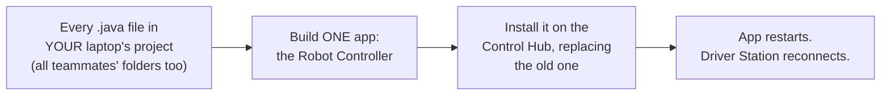

# Deploying and Managing Programs

How your code gets from Android Studio onto the robot, and how to keep the Driver Station menu
from turning into a 100-item mess.

---

## What a deploy actually does
When you click **▶ Run**, Android Studio does **not** send just your one file. It:



Three things follow from that:
1. **The robot gets your laptop's copy of *everyone's* code.** If you haven't pulled, teammates'
   newest programs disappear from the robot (or programs they deleted come back).
   ➜ **Always pull before you deploy.**
2. **One broken file anywhere breaks the build for the whole group.** If a teammate pushed code
   with a red error, nobody can deploy until it's fixed.
   ➜ **Never push code that doesn't build.** (🔨 **Build → Make Project** first.)
3. **Removing a program from the menu means changing the code and deploying again.**
   You never delete programs on the robot itself. (The one exception is
   [old Blocks and OnBot Java programs](#leftover-blocks-and-onbot-java-programs).)

**The menu shows:** every OpMode in the deployed app *without* `@Disabled`, **plus** any Blocks
or OnBot Java programs saved on the hub.

---

## Deploy over USB (the usual way)
1. Turn the robot on. Plug the Control Hub into your laptop with a USB-C **data** cable.
2. In the device dropdown at the top of Android Studio, pick **REV Robotics Control Hub**.
3. Make sure the run dropdown next to it says **TeamCode**.
4. Click **▶ Run**. Watch the bottom bar: *Gradle build* → *Installing* → *Launch succeeded*.
5. Wait about 15–30 seconds for the Driver Station to reconnect.

**Taking turns:** only one laptop deploys at a time. Whoever deploys last decides what's on the
robot, which is why everyone pulls first.

## Deploy over Wi-Fi (once you're comfortable)
Useful when the robot is on the field and you don't want to chase it with a cable.
1. Connect your laptop's Wi-Fi to the **Control Hub's network**. The name and password are in the
   Driver Station menu (⋮) → **Program & Manage**.
   ⚠️ While you're on the robot's Wi-Fi, your laptop has **no internet**, so you can't pull or
   push. Pull *before* you switch networks.
2. In Android Studio, open the **Terminal** tab (bottom) and run:
   ```powershell
   & "$env:LOCALAPPDATA\Android\Sdk\platform-tools\adb.exe" connect 192.168.43.1:5555
   ```
   You should see `connected to 192.168.43.1:5555`.
3. The device dropdown now shows the hub. Click **▶ Run** like normal.
4. Reconnect to school Wi-Fi afterward so you can push.

---

## Cleaning up the Driver Station menu
Each lesson adds a program to your folder. By Week 6 your group could have 50+ programs on the
menu. Two tools fix that:

### Option 1: `@Disabled` (hide it, keep it)
Add one line right under the `@TeleOp` or `@Autonomous` line:
```java
@TeleOp(name = "L05 Tank Drive - Ava", group = "Ava")
@Disabled
public class L05_TankDrive extends LinearOpMode {
```
If Android Studio underlines `@Disabled` in red, click it and press **Alt+Enter → Import class**.
Commit, push, then deploy (after pulling). The program disappears from the menu, but the file
stays, so you can still look back at it or delete `@Disabled` to bring it back.

✅ **Use this for most old lessons.** You'll want to look back at your code later.

### Option 2: Delete the file (gone for good… almost)
Right-click the file in Android Studio → **Delete**. Commit, push, deploy.
Git still remembers it. In GitHub Desktop, open the **History** tab, find an older commit, and
the file is there. Nothing you ever committed is truly lost.

✅ **Use this for experiments and junk files.**

### Group menu rule
Agree on a limit as a group. A good one: **each person keeps at most 3 of their own programs
enabled** (the current lesson and the one or two you're still working on). Do a cleanup on
catch-up days.

### Why the teacher's originals are hidden
Every file in `lessons/` already has `@Disabled`, so the 17 originals never clutter the menu.
When you copy a lesson into your folder, **delete the `@Disabled` line in your copy** so it
appears. If your copy isn't showing up, check for that line first.

---

## Leftover Blocks and OnBot Java programs
Programs made in **Blocks** or **OnBot Java** (from past seasons, maybe) are saved **on the
hub** itself, not in your project. An Android Studio deploy does **not** remove them.
To clear them:
1. Connect your laptop to the Control Hub's Wi-Fi (see above).
2. In a web browser, go to the address shown under **Program & Manage** (usually
   `http://192.168.43.1:8080`).
3. **Blocks** tab: **download** any program worth keeping, then select the programs and delete them.
4. **OnBot Java** tab: same idea. Download anything worth keeping, then delete the files.
   Old OnBot Java files can clash with Android Studio classes that have the same name, so
   it's best to clear them out.
5. Restart the robot (Driver Station ⋮ → **Restart Robot**).

👩‍🏫 *Teachers: do this once per hub before Lesson 00 so students start with a clean menu.*

---

## Deploy troubleshooting
| What you see | What it means | Fix |
|---|---|---|
| Hub isn't in the device dropdown | Cable, power, or connection | Robot on? Try another cable (some only charge) and another USB port. Over Wi-Fi, run `adb connect` again. |
| Build fails with an error in **someone else's** folder | A teammate pushed broken code | Tell them. They fix it, push, and you pull. (Rule: never push code that doesn't build.) |
| Build fails in **your** file | Your code has an error | Click the error in the **Build** tab to jump to the line. |
| "Installation did not succeed… signatures do not match" and an offer to uninstall | The app on the hub was installed from a different laptop | Click **OK** to uninstall and reinstall. Robot configurations are saved as separate files on the hub and normally survive this. Know your configuration names (they're in the course README) just in case. |
| *Launch succeeded* but my changes aren't there | Wrong run target, or the Driver Station is still on the old app | Check that the run dropdown says **TeamCode**. Wait for the Driver Station to reconnect, or use ⋮ → **Restart Robot**. |
| My program isn't on the menu | `@Disabled` still in the file, a duplicate name, or you're looking in the wrong list | Delete `@Disabled`. Make the `name` unique. TeleOps and Autonomous programs are in **separate** menus. |
| A teammate's program vanished from the robot | Someone deployed without pulling | Pull, then deploy again. |
| A program I deleted is back | Someone deployed without pulling | Same fix: pull, then deploy. |
